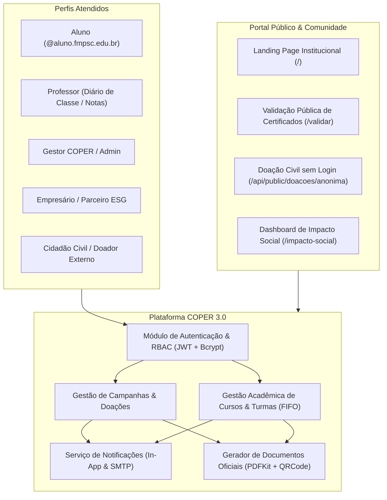
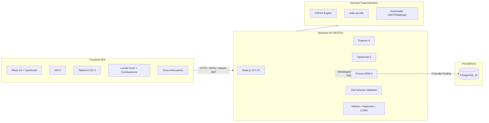

# 01. Contexto e Visão Geral do Produto

---

## 1. Identificação Acadêmica e Institucional

| Campo | Detalhe |
| :--- | :--- |
| **Instituição de Ensino** | Faculdade Municipal de Palhoça (FMP) |
| **Curso Superior** | Tecnologia em Análise e Desenvolvimento de Sistemas (ADS) |
| **Unidade Curricular** | Projeto Integrador III (4ª Fase) |
| **Ano / Semestre** | 2026.1 |
| **Professora Orientadora** | Profa. Me. Daniela Amorim |
| **Equipe de Desenvolvimento** | • Lucas Alexandre Vieira Schutz<br>• Eduardo da Silva<br>• Davi Aravecchia<br>• Vitor Emanuel<br>• Nicolas |
| **Órgão Beneficiário Interno** | Coordenação de Extensão e Responsabilidade Social (COPER - FMP) |

---

## 2. Problema de Negócio e Motivação

Historicamente, a **Coordenação de Extensão e Responsabilidade Social (COPER)** da Faculdade Municipal de Palhoça gerenciava suas iniciativas humanitárias, campanhas de arrecadação e oficinas comunitárias por meio de métodos manuais e descentralizados:

```
[Fluxo Legado Manual]
Cadernos Físicos de Balcão ──> Planilhas Excel Isoladas ──> Google Forms de Inscrição ──> Certificados em Papel
      (Risco de Perda)           (Fórmulas Quebradas)          (Falta de Limite de Vagas)      (Sem Rastreabilidade)
```

### Principais Dores Identificadas no Cenário Anterior:
1. **Falta de Auditoria e Fraude Potencial:** Inexistência de um identificador único ou hash criptográfico para atestar se uma declaração de horas complementares entregue à Secretaria Acadêmica era autêntica.
2. **Controle Manual de Horas e Limites Semestrais:** Alunos frequentemente excediam o teto de horas semestrais por categoria sem detecção prévia, gerando retrabalho no fechamento das formaturas.
3. **Gestão Caótica de Oficinas e Cursos (ex: Libras):** Inscrições feitas por formulários externos sem validação de vagas em tempo real, gerando superlotação em sala, falta de critério para desistências e ausência de uma fila de espera transparente.
4. **Diário de Classe Fragmentado:** Chamadas de frequência e notas de cursos de extensão preenchidas em folhas avulsas, ocasionando atrasos de meses na emissão de certificados.
5. **Comunidade e Empresas Invisíveis:** Cidadãos e empresas parceiras não dispunham de um canal institucional aberto para doação com acompanhamento transparente e dados de impacto social para balanços de sustentabilidade (ESG).

---

## 3. Visão do Produto — Sistema COPER 3.0

O **Sistema COPER 3.0** foi concebido como uma plataforma corporativa integrada, resiliente e segura, unificando em um único ecossistema:
- **Gestão Humanitária e Doações:** Cadastro, triagem, validação física no balcão e conversão de itens em horas complementares acadêmicas (exclusivas para alunos).
- **Módulo Acadêmico Extracurricular:** Gestão de cursos livres e oficinas da faculdade (ex: Libras e Cidadania Digital), controle rigoroso de turmas, inscrições em tempo real com **Fila de Espera Automática (FIFO)**, diário de classe digital com frequência acumulada e lançamento de avaliações **A1, A2 e A3**.
- **Autenticidade e Fé Pública Digital (Modelo Unisul / FMP):** Geração instantânea de comprovantes e diplomas em PDF com QR Code dinâmico e código hash UUIDv4, permitindo que qualquer cidadão, empresa ou órgão acadêmico valide o documento online sem login.
- **Transparência Pública e Responsabilidade Social:** Landing Page institucional aberta com dados de impacto comunitário, metas em tempo real e canal de pré-cadastro de doação para civis.



---

## 4. Pilares Estratégicos da Versão 3.0

### 4.1. Rigor Acadêmico e Equidade
- Somente alunos regularmente matriculados na FMP acumulam horas complementares.
- Professores, civis e empresários podem doar solidariamente, recebendo recibos fiscais/comprovantes oficiais de doação sem cômputo de horas acadêmicas.

### 4.2. Algoritmo Transacional de Vagas (FIFO)
- Turmas com limite estrito de vagas. Se a capacidade for atingida, novas inscrições entram na **Fila de Espera** sequencialmente (`1, 2, 3...`).
- Se um aluno cancela sua inscrição dentro do prazo regulamentar, uma transação atômica promove automaticamente o 1º colocado da fila para vaga ativa e despacha notificação com link de confirmação.

### 4.3. Avaliação e Frequência Contínua
- Cursos possuem regime semestral com registro de faltas aula a aula.
- Notas estruturadas em **A1, A2 e A3**. A aprovação e emissão de certificado exigem simultaneamente:
  $$\text{Frequência} \ge 75\% \quad \text{e} \quad \text{Média Final} \ge 7.0$$

### 4.4. Conformidade e Retenção de Dados
- Em obediência às diretrizes da FMP e à **Lei Geral de Proteção de Dados (LGPD)**, dados operacionais possuem política de retenção estrita de **2 anos**, com relatórios de auditoria limitados a janelas de até 1 ano.

---

## 5. Stack Tecnológica e Engenharia



### Resumo das Especificações Técnicas:

| Camada | Tecnologia | Justificativa Técnica |
| :--- | :--- | :--- |
| **Runtime Backend** | Node.js (v22.x LTS) | Eficiência I/O assíncrona, ecossistema unificado TypeScript com o frontend. |
| **Framework Web** | Express.js | Arquitetura minimalista com middlewares desacoplados para validação, rate-limit e RBAC. |
| **Tipagem & Compilação** | TypeScript 5.8 | Segurança de tipos em tempo de compilação, prevenindo erros de tipagem em regras de negócio. |
| **ORM / Banco de Dados** | Prisma ORM + PostgreSQL 16 | Migrations reproduzíveis, integridade referencial nativa, schemas fortemente tipados. |
| **Validação de Entrada** | Zod | Validação declarativa de requisições (`req.body`, `req.query`, `req.params`) antes da camada de use-case. |
| **Segurança HTTP** | Helmet, Express-Rate-Limit, CORS | Proteção contra ataques de força bruta, headers de segurança e sanitização DoS. |
| **Motor de Documentos** | PDFKit + node-qrcode | Geração de PDFs em memória (Streams) com layout vetorial profissional e QR Codes incorporados. |
| **Notificações** | Nodemailer + Serviço In-App | Notificação por e-mail e canal in-app para alertas de promoção em fila e validações. |
| **Frontend Framework** | React 19 + Vite | SPA de alta performance com hot module replacement e renderização eficiente de dashboards. |
| **Estilização** | Tailwind CSS + CSS Modules | Paleta Dark Mode institucional em azul profundo (`#06233B`), ciano/teal (`#38bdf8`) e ardósia. |
| **Testes Automatizados** | Vitest | Execução paralela ultra-rápida de testes unitários e de integração de regras de negócio. |

---

## 6. Estrutura e Mapa da Documentação (v3.0)

A documentação técnica oficial do Sistema COPER 3.0 está organizada na pasta [`documentacao/`](file:///c:/Users/lucas/Downloads/gestaodoacaonovo/documentacao):

1. [**01. Contexto e Visão Geral do Produto**](file:///c:/Users/lucas/Downloads/gestaodoacaonovo/documentacao/01-contexto-e-visao-geral.md): Identificação da equipe acadêmica, motivação, dores e stack tecnológica.
2. [**02. Requisitos e Regras de Negócio**](file:///c:/Users/lucas/Downloads/gestaodoacaonovo/documentacao/02-requisitos-e-regras-de-negocio.md): Catálogo de requisitos funcionais (`RF01` a `RF20`), não funcionais (`RNF01` a `RNF06`) e regras de negócio (`RN01` a `RN16`).
3. [**03. Especificação de Casos de Uso**](file:///c:/Users/lucas/Downloads/gestaodoacaonovo/documentacao/03-casos-de-uso.md): Diagrama geral de casos de uso e especificação minuciosa de `UC01` a `UC16`.
4. [**04. Arquitetura de Software e Banco de Dados**](file:///c:/Users/lucas/Downloads/gestaodoacaonovo/documentacao/04-arquitetura-e-banco-de-dados.md): Componentes, Matriz RBAC, Diagrama Entidade-Relacionamento (DER), dicionário de dados e catálogo de endpoints REST.
5. [**05. Plano de Testes e Garantia de Qualidade (QA)**](file:///c:/Users/lucas/Downloads/gestaodoacaonovo/documentacao/05-plano-de-testes-e-qa.md): Matriz de testes (`T01` a `T16`) e relatório de execução dos 33 testes automatizados via Vitest.
6. [**06. Histórico de Versões e Changelog**](file:///c:/Users/lucas/Downloads/gestaodoacaonovo/documentacao/06-historico-versoes-changelog.md): Linha do tempo evolutiva (v1.0, v2.0 Java legado e v3.0 Node/React atual) e matriz comparativa.
7. [**07. Diagramas UML do Sistema**](file:///c:/Users/lucas/Downloads/gestaodoacaonovo/documentacao/07-diagramas-uml.md): Diagrama estrutural de classes completo e diagramas de sequência dos fluxos de doação e acadêmico/FIFO.

