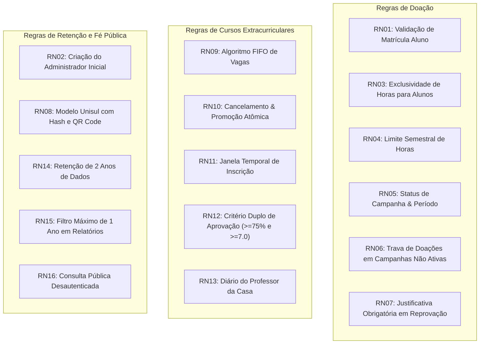

# 02. Requisitos e Regras de Negócio — Sistema COPER 3.0

---

## 1. Requisitos Funcionais (RF)

| ID | Nome do Requisito | Prioridade | Perfis Envolvidos | Descrição Detalhada |
| :--- | :--- | :---: | :--- | :--- |
| **RF01** | **Autenticação e Cadastro Multi-Perfil** | Alta | Todos | O sistema deve prover registro e login com autenticação JWT. Perfis: • `ALUNO`: Exige matrícula e e-mail com sufixo obrigatório `@aluno.fmpsc.edu.br`. • `PROFESSOR`: Cadastro com e-mail institucional ou CPF. • `COPER`: Perfil gestor/administrador pleno. • `CIVIL`: Cadastro externo com CPF, e-mail pessoal e endereço residencial. • `EMPRESARIO`: Perfil de acesso a relatórios e balanços de impacto social. |
| **RF02** | **Recuperação de Senha por Token Temporário** | Alta | Todos | Envio de e-mail institucional/pessoal contendo token seguro com validade estrita de **1 hora** para redefinição de credenciais de acesso. |
| **RF03** | **Landing Page Pública e Doação sem Login** | Alta | Público, Civil, Empresário | Portal público na raiz (`/`) com indicadores dinâmicos de impacto social, vitrine de campanhas categorizadas (`Ativas`, `Futuras` e `Encerradas`, com exibição de **data de início e data limite**) e modal de pré-cadastro de doação para civis sem login (solicitando CPF, nome, endereço, contato e itens). |
| **RF04** | **Gestão de Itens Prioritários e Urgências** | Média | COPER | A COPER pode cadastrar itens com metas quantitativas e níveis de urgência (`NORMAL`, `MEDIA`, `ALTA`). Itens com urgência alta recebem destaque visual na vitrine e nos painéis de alunos e doadores. |
| **RF05** | **Registro de Doações no Balcão e Solicitações** | Alta | Aluno, Civil, Professor, COPER | Registro de nova doação vinculada a uma campanha ativa, com foto da evidência, descrição dos itens, quantidade e identificação do recebedor no balcão da COPER. O status inicial é invariavelmente `PENDING` (Pendente). |
| **RF06** | **Validação e Homologação de Doações** | Alta | COPER | Apenas o perfil COPER pode homologar (`APPROVED`) ou reprovar (`REJECTED`) doações físicas. Em caso de aprovação para alunos, verifica-se a matrícula ativa (`isActive: true`) e computam-se as horas. Em caso de reprovação, o preenchimento de `rejectionReason` é obrigatório. |
| **RF07** | **Histórico e Retenção de 2 Anos** | Alta | Aluno, COPER | Consulta ao histórico completo de doações com período máximo de busca e retenção de **2 anos**. Doações de civis e professores constam no histórico institucional sem cômputo de horas complementares. |
| **RF08** | **Consulta de Saldo de Horas Complementares** | Alta | Aluno | Painel exclusivo para o aluno consultar horas homologadas (`Aprovadas`), horas em análise (`Pendentes`), horas indeferidas (`Reprovadas`) e saldo restante até o limite semestral da categoria. |
| **RF09** | **Sistema de Notificações Multicanal** | Média | Todos | Despacho automático de notificações internas (in-app) e e-mails transacionais (Nodemailer) quando houver: mudança de status da doação, convocação/promoção na fila de espera de turmas e emissão de certificados. |
| **RF10** | **Comprovante Oficial em PDF para Aluno** | Alta | Aluno, COPER | Geração e download do **Modelo 1**: Comprovante com cabeçalho oficial da FMP, nome completo, matrícula, e-mail institucional, itens doados, **horas complementares concedidas**, identificação do atendente e validador, carimbo de data/hora, código hash UUID e QR Code de auditoria. |
| **RF11** | **Comprovante Oficial em PDF para Civil / Professor** | Alta | Civil, Professor, COPER | Geração e download do **Modelo 2**: Comprovante de doação solidária com CPF, nome, itens recebidos, equipe validadora, hash UUID e QR Code, **sem nenhuma menção a horas acadêmicas complementares**. |
| **RF12** | **Regras de Conversão e Tetos Semestrais** | Média | Aluno, COPER | Exibição das regras de equivalência (ex: "5kg de alimentos = 5 horas") e trava sistêmica para impedir que um aluno ultrapasse o teto semestral estabelecido pelo Colegiado de ADS. |
| **RF13** | **Relatórios Consolidados de Impacto** | Alta | COPER, Empresário | Emissão de relatórios gerenciais analíticos e estatísticos filtrados por campanha e período (limitados a janelas de até **1 ano**, dentro da janela de retenção de **2 anos**), permitindo exportação e visualização agregada para balanços de sustentabilidade (ESG). |
| **RF14** | **Pesquisa Global Multifacetada** | Média | COPER | Barra de busca instantânea no painel administrativo capaz de pesquisar simultaneamente por nome do aluno, número de matrícula, título de campanha ou código hash de doação. |
| **RF15** | **Controle de Acesso Baseado em Perfis (RBAC)** | Alta | Todos | Middlewares de autorização estritos que protegem rotas e dados de acordo com os 5 papéis: `ALUNO`, `PROFESSOR`, `COPER`, `EMPRESARIO` e `CIVIL`. |
| **RF16** | **Gestão de Cursos e Turmas Extracurriculares** | Alta | COPER | Cadastro de cursos (título, descrição, carga horária, professor responsável) e turmas (capacidade máxima de vagas, data de início e término das aulas, período exato de abertura/fechamento das inscrições e prazo limite de cancelamento/desistência). |
| **RF17** | **Inscrição com Fila de Espera Automática (FIFO)** | Alta | Aluno | Inscrição direta de alunos logados. Se `inscritos_ativos < capacidade`, status = `ACTIVE`. Se a turma estiver lotada, status = `WAITLIST` com ordenação sequencial estrita (`1, 2, 3...`). Caso um aluno ativo cancele dentro do prazo, o 1º da fila é promovido imediatamente para `ACTIVE` de forma atômica. |
| **RF18** | **Diário de Classe Digital do Professor** | Alta | Professor, COPER | Interface para o docente registrar a chamada online aula a aula (com cálculo da porcentagem acumulada de frequência) e lançar as avaliações **A1, A2 e A3** (notas de 0.0 a 10.0) para cada aluno matriculado. |
| **RF19** | **Encerramento de Turma e Emissão de Certificados** | Alta | Professor, COPER, Aluno | Fechamento da turma com validação automática dos critérios de aprovação ($\text{frequência} \ge 75\%$ e $\text{média} \ge 7.0$). Para os aprovados, o sistema gera o **Modelo 3**: Diploma em formato paisagem com carga horária, período, instrutor, hash único e QR Code. |
| **RF20** | **Validação Pública de Autenticidade sem Login** | Alta | Público, Empresas | Página pública `/validar` que recebe o código hash via formulário ou parâmetro de URL (`/validar?code=HASH`), consultando a base e exibindo os dados auditáveis do documento (doação ou certificado de curso), atestando a fé pública da FMP. |

---

## 2. Requisitos Não Funcionais (RNF)

| ID | Requisito Não Funcional | Categoria | Descrição e Critério de Aceite |
| :--- | :--- | :---: | :--- |
| **RNF01** | **Interface Acessível e Identidade Visual** | Usabilidade | Design responsivo seguindo tema Dark Mode institucional em azul profundo (`#06233B`), ardósia (`#0f172a`), acentos em ciano/teal (`#38bdf8`) e alto contraste de texto (WCAG 2.1 nível AA). |
| **RNF02** | **Responsividade Mobile-First** | Compatibilidade | Todas as páginas do portal público, painel do aluno e diário do professor devem operar perfeitamente em telas de smartphones (largura $\ge 360\text{px}$), tablets e desktops. |
| **RNF03** | **Tempo de Resposta e Desempenho** | Performance | 95% das consultas de listagem e endpoints públicos de validação devem responder em tempo inferior a **1.5 segundo** sob carga moderada; geração de PDFs com QR Code em até **3 segundos**. |
| **RNF04** | **Disponibilidade e Confiabilidade** | Operação | O sistema deve apresentar disponibilidade projetada de **99.5%** em ambiente de produção (24 horas por dia, 7 dias por semana). |
| **RNF05** | **Segurança, Criptografia e LGPD** | Segurança | Senhas com hash salgado via `bcryptjs` (custo $\ge 10$); autenticação Stateless via tokens JWT (Access Token de 1h e Refresh Token em banco); rate limiting em rotas sensíveis; comunicação HTTPS; proteção contra injeção SQL nativa via Prisma ORM e mascaramento de dados sensíveis para perfis de parceiros (LGPD). |
| **RNF06** | **Política de Retenção e Backups** | Persistência | Histórico operacional mantido estritamente pelo período de **2 anos** contados a partir da data de encerramento da doação ou curso. Rotina diária de backup automatizado da base PostgreSQL. |

---

## 3. Catálogo de Regras de Negócio (RN)

### Detalhamento das Regras de Negócio:

#### **RN01 — Validação Cadastral de Matrícula Ativa**
O perfil `ALUNO` só pode ser registrado com e-mail pertencente ao domínio oficial da faculdade: `@aluno.fmpsc.edu.br` e matrícula preenchida. Para que uma doação seja aprovada com cômputo de horas, o campo `isActive` do usuário deve estar obrigatoriamente como `true`.

#### **RN02 — Criação e Imunidade do Administrador Inicial**
O seed inicial da aplicação cria automaticamente o usuário gestor COPER (`admin.coper@fmpsc.edu.br`). Usuários com o perfil `COPER` possuem permissão total de gerenciamento e não podem ser excluídos por endpoints comuns sem autorização de nível raiz.

#### **RN03 — Exclusividade de Horas Complementares para Alunos**
Apenas usuários autenticados com o perfil `ALUNO` acumulam saldo no campo `total_hours_earned` e recebem o **Modelo 1** de comprovante. Doações realizadas por `CIVIL`, `PROFESSOR` ou `EMPRESARIO` geram comprovante fiscal de agradecimento (**Modelo 2**), mas com saldo de horas nulo ($0.0$).

#### **RN04 — Limite Máximo Semestral de Horas por Aluno**
Cada aluno possui um teto de horas estipulado pela coordenação do curso de ADS (padrão de até 40 horas semestrais em atividades extensionistas). A validação da doação pelo gestor é bloqueada ou ajustada caso a soma das horas exceda o teto cadastrado em `semester_hours_limit`.

#### **RN05 — Ciclo de Vida e Período de Campanhas (`data_inicio` e `data_limite`)**
Toda campanha de arrecadação possui obrigatoriamente uma **Data de Início** (`start_date`) e, opcionalmente, uma **Data Limite** (`end_date`). Na criação ou edição, o sistema rejeita requisições onde $\text{data\_limite} < \text{data\_inicio}$. O status operacional é calculado dinamicamente:
- **`FUTURA`:** Quando $\text{Data Atual} < \text{data\_inicio}$;
- **`ATIVA`:** Quando $\text{data\_inicio} \le \text{Data Atual} \le \text{data\_limite}$ (e a campanha não tiver sido encerrada antecipadamente);
- **`ENCERRADA`:** Quando $\text{Data Atual} > \text{data\_limite}$ ou quando o gestor COPER executar a ação de encerramento manual.

#### **RN06 — Trava de Doação para Campanhas Inativas**
É terminantemente proibido registrar ou submeter doações para campanhas com status `FUTURA` ou `ENCERRADA`. O backend rejeita a tentativa com código HTTP `400 Bad Request`.

#### **RN07 — Obrigatoriedade de Parecer em Reprovações**
Ao rejeitar uma doação no balcão, a equipe COPER deve obrigatoriamente preencher o campo `rejectionReason`, informando o motivo formal (ex: "Alimentos vencidos", "Vestuário rasgado/sem condições de uso", "Aluno inativo").

#### **RN08 — Fé Pública e Certificação Digital (Modelo Unisul / FMP)**
Todo documento oficial emitido (Comprovante Modelo 1, Comprovante Modelo 2 ou Diploma Modelo 3) deve carregar um código hash alfanumérico único gerado via padrão **UUIDv4** e um **QR Code dinâmico** apontando para o endpoint oficial de auditoria:
$$\text{URL de Auditoria} = \text{FRONTEND\_URL} + \text{/validar?code=} + \text{authHash}$$

#### **RN09 — Gestão de Capacidade e Algoritmo FIFO de Vagas**
As turmas de cursos extracurriculares possuem limite fixo de vagas (`max_capacity`). Quando um aluno solicita matrícula:
- Se $\text{Vagas Ocupadas} < \text{max\_capacity}$, a matrícula é confirmada com status `ACTIVE` e `waitlistPosition = null`.
- Se a capacidade foi atingida, a matrícula recebe status `WAITLIST` e é alocada no final da fila:
  $$\text{waitlistPosition} = \max(\text{posições existentes}) + 1$$

#### **RN10 — Cancelamento e Promoção Transacional Atômica**
Alunos com matrícula `ACTIVE` podem desistir do curso até a data `cancellationDeadline`. Havendo desistência, o sistema executa uma transação de banco com isolamento serial:
1. Marca a inscrição do desistente como `CANCELLED`;
2. Localiza o aluno com $\text{waitlistPosition} = 1$;
3. Promove este aluno para status `ACTIVE` com $\text{waitlistPosition} = \text{null}$;
4. Decrementa em $1$ a posição de todos os alunos subsequentes da fila;
5. Dispara e-mail e notificação in-app informando a liberação da vaga ao promovido.

#### **RN11 — Janela Temporal de Inscrições em Cursos**
As inscrições para turmas só são aceitas dentro do intervalo estipulado:
$$\text{enrollmentStartDate} \le \text{Data Atual} \le \text{enrollmentEndDate}$$
Antes ou depois desse intervalo, tentativas de inscrição resultam em erro e a interface desabilita os botões de ação.

#### **RN12 — Critério Duplo de Aprovação em Cursos Extracurriculares**
Para conclusão com êxito e obtenção de certificado do curso, o aluno matriculado em turma finalizada (`FINISHED`) deve satisfazer cumulativamente:
1. **Frequência Mínima:** $\text{attendancePercentage} \ge \text{minAttendancePct}$ (padrão institucional: $75\%$);
2. **Desempenho Acadêmico:** Média das avaliações formativas $\ge \text{minGrade}$ (padrão institucional: $7.0$), sendo calculada como:
   $$\text{Média Final} = \frac{A_1 + A_2 + A_3}{3}$$
Alunos que não atingirem ambos os critérios são marcados como `FAILED` e não têm direito à emissão de certificado.

#### **RN13 — Atribuição Docente do Diário de Classe**
Apenas o professor titular vinculado à turma (`instructorId`) ou um gestor do perfil `COPER` possuem permissão para realizar o registro de presenças/faltas e o lançamento das notas $A_1$, $A_2$ e $A_3$.

#### **RN14 — Política de Retenção de Dados por 2 Anos (LGPD)**
Todos os registros de doações, presenças, inscrições em cursos e notificações possuem prazo de retenção operacional de **2 anos**. Consultas a períodos anteriores são expurgadas ou arquivadas, em conformidade com as diretrizes de governança da FMP.

#### **RN15 — Limite Temporal de Filtros em Relatórios Analíticos**
Para preservar a estabilidade do banco de dados e evitar consultas excessivamente custosas, os relatórios consolidados exigem intervalos de busca com amplitude máxima de **até 1 ano** entre a data inicial e a data final selecionada.

#### **RN16 — Desacoplamento da Consulta Pública de Autenticidade**
O endpoint de consulta de certificados e comprovantes (`/api/public/validar` e a rota frontend `/validar`) é 100% público, permitindo auditorias externas sem necessidade de credenciais de login ou captura de cookies de sessão do consultante.
