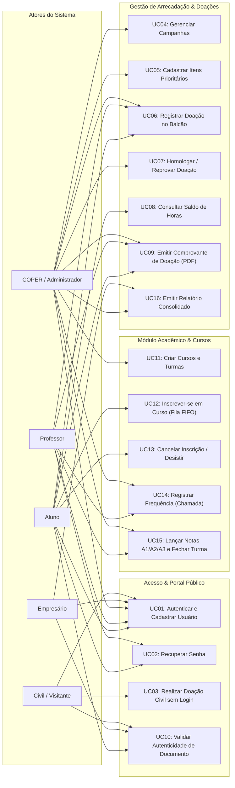

# 03. Especificação de Casos de Uso — Sistema COPER 3.0

---

## 1. Diagrama Geral de Casos de Uso (Mermaid)

---

## 2. Detalhamento dos Casos de Uso

---

### UC01: Realizar Cadastro e Login no Sistema (Multi-Perfil)
- **Ator Principal:** Qualquer usuário (`Aluno`, `Professor`, `COPER`, `Empresário`, `Civil`).
- **Pré-condições:** Acesso à internet e navegador web compatível.
- **Fluxo Principal:**
  1. O usuário acessa a rota `/login` e seleciona entre as abas "Acessar Conta" ou "Criar Cadastro".
  2. No cadastro, o usuário informa Nome Completo, CPF, E-mail, Senha e Perfil desejado.
  3. Se selecionar `Aluno`, o sistema exige matrícula acadêmica e valida se o e-mail possui o domínio `@aluno.fmpsc.edu.br`.
  4. O sistema gera o hash seguro da senha com `bcryptjs` (salt 10) e persiste o registro no banco PostgreSQL.
  5. Para login, o usuário informa E-mail/CPF e Senha.
  6. O backend valida as credenciais e emite um par de tokens: **Access Token (JWT)** válido por 1 hora e **Refresh Token** armazenado na tabela `refresh_tokens`.
  7. O frontend armazena a sessão e redireciona o usuário para o painel correspondente ao seu perfil (ex: `/dashboard` para COPER, `/meu-painel` para Aluno, `/diario-classe` para Professor, `/painel-impacto` para Empresário).
- **Fluxos Alternativos / Exceções:**
  - *1a. Aluno tenta cadastrar e-mail comum (ex: Gmail):* O sistema bloqueia a requisição informando: "Cadastro de aluno exige e-mail institucional @aluno.fmpsc.edu.br".
  - *1b. CPF ou e-mail já existente:* Retorna erro HTTP 409 informando duplicidade cadastral.
  - *1c. Mais de 25 tentativas de login em 15 minutos:* O middleware de rate limiting bloqueia temporariamente o IP do solicitante (HTTP 429).
- **Pós-condições:** Usuário autenticado com perfil RBAC e permissões ativas.

---

### UC02: Recuperar Senha de Acesso via E-mail
- **Ator Principal:** Qualquer usuário cadastrado.
- **Pré-condições:** Usuário previamente registrado no sistema.
- **Fluxo Principal:**
  1. Na tela de login, o usuário clica em "Esqueci minha senha".
  2. Informa seu e-mail cadastrado e submete o formulário.
  3. O backend gera um token criptográfico único (`PasswordResetToken`) com expiração de 1 hora.
  4. O serviço de e-mail (`MailService` / Nodemailer) despacha mensagem contendo o link seguro de redefinição.
  5. O usuário clica no link, informa a nova senha e confirma.
  6. O sistema atualiza o `password_hash`, invalida o token usado (`usedAt = now()`) e revoga tokens de sessão anteriores.
- **Fluxos Alternativos / Exceções:**
  - *2a. E-mail não localizado:* Por razões de segurança (prevenção de enumeração), o sistema informa que caso o e-mail exista, as instruções foram enviadas.
  - *2b. Token expirado (> 1 hora) ou já utilizado:* Exibe mensagem de erro solicitando nova solicitação.
- **Pós-condições:** Senha redefinida e conta pronta para novo login.

---

### UC03: Pré-Cadastrar Doação Civil sem Login (Landing Page)
- **Ator Principal:** Cidadão Civil / Comunidade Externa.
- **Pré-condições:** Nenhuma (acesso público à Landing Page `/`).
- **Fluxo Principal:**
  1. O visitante visualiza as campanhas ativas na Landing Page e clica em "Doar para esta Campanha" ou no botão "Doar sem Cadastro".
  2. O modal de Doação Civil é aberto, solicitando Nome Completo, CPF (11 dígitos), Telefone, E-mail, Campanha de destino, Tipo de Item, Categoria (Alimentos, Vestuário, etc.) e Quantidade.
  3. O visitante envia o formulário. O endpoint `POST /api/public/doacoes/anonima` valida a integridade via schema Zod.
  4. O sistema verifica se a campanha informada está com status `ACTIVE` (rejeitando se for `FUTURA` ou `ENCERRADA`).
  5. O sistema vincula o registro ao usuário ou a um perfil genérico de doador civil, gera um código **UUID de Autenticidade (Hash)** e persiste a doação como `PENDING`.
  6. A tela exibe card de sucesso em destaque com o código Hash e instruções para entrega presencial no balcão da COPER na FMP.
- **Fluxos Alternativos / Exceções:**
  - *3a. Campanha selecionada não está ativa:* Mensagem informa que a campanha está encerrada ou ainda não foi iniciada, sugerindo a escolha de outra ação ativa.
- **Pós-condições:** Pré-registro criado no banco de dados com status `PENDING` aguardando triagem física no balcão.

---

### UC04: Criar e Gerenciar Campanhas de Doação (com Data de Início e Limite)
- **Ator Principal:** Gestor COPER.
- **Pré-condições:** Autenticado com perfil `COPER`.
- **Fluxo Principal:**
  1. O gestor navega para `/campanhas`.
  2. Preenche o formulário informando: Título, Descrição, **Data de Início** (`start_date`), **Data Limite** (`end_date`), Limite de Horas e Itens Prioritários com metas.
  3. O sistema valida se `end_date >= start_date` e computa o status automático (`FUTURA` se data atual < início, `ATIVA` se dentro do intervalo).
  4. A campanha é salva no banco e passa a constar imediatamente na listagem do painel e na vitrine da Landing Page.
  5. O gestor pode editar os dados a qualquer momento ou clicar em "Encerrar", mudando o status para `CLOSED`.
- **Fluxos Alternativos / Exceções:**
  - *4a. Data limite anterior à data de início:* Zod rejeita com mensagem: "A data limite deve ser igual ou posterior à data de início".
- **Pós-condições:** Campanha registrada com status calculado e visibilidade configurada.

---

### UC05: Cadastrar Itens Prioritários e Níveis de Urgência
- **Ator Principal:** Gestor COPER.
- **Pré-condições:** Autenticado como `COPER` e campanha existente.
- **Fluxo Principal:**
  1. O gestor acessa a gestão de itens prioritários da campanha.
  2. Informa o nome do item (ex: "Leite em Pó", "Cobertores"), a meta quantitativa e o nível de urgência (`NORMAL`, `MEDIA`, `ALTA`).
  3. O item é persistido na tabela `priority_items`.
  4. Itens com urgência alta recebem destaque visual na vitrine e nos cards de arrecadação.
- **Pós-condições:** Itens salvos e refletidos nos filtros de busca da plataforma.

---

### UC06: Registrar Nova Doação de Materiais no Balcão COPER
- **Ator Principal:** Gestor COPER (ou aluno registrando solicitação de entrega).
- **Pré-condições:** Usuário autenticado.
- **Fluxo Principal:**
  1. No menu lateral, clica-se em "Registrar Doação" (`/registrar-doacao`).
  2. Informa a Matrícula do Aluno (opcional caso seja doação solidária de professor/civil), seleciona a Campanha (apenas ativas são listadas), Tipo do Item, Quantidade, Local de Entrega e anexa foto da evidência.
  3. Submete o registro via `multipart/form-data`.
  4. O sistema grava a doação com status `PENDING`, gera o hash e vincula o usuário recebedor (`received_by_id`).
- **Fluxos Alternativos / Exceções:**
  - *6a. Matrícula informada não existe:* Mensagem de erro avisa que o aluno não foi localizado na base da faculdade.
- **Pós-condições:** Doação registrada com pendência de validação.

---

### UC07: Homologar / Reprovar Doação e Conceder Horas Complementares
- **Ator Principal:** Gestor COPER.
- **Pré-condições:** Autenticado como `COPER` e existência de doações pendentes.
- **Fluxo Principal:**
  1. O gestor acessa `/validar-doacoes`.
  2. Visualiza a lista de itens pendentes, fotos anexadas, dados do doador e regras de conversão da campanha.
  3. **Caso Aprove:**
     - Define a quantidade de horas complementares a serem concedidas (ex: 5h, 10h).
     - O sistema verifica se o doador é `ALUNO` e se sua matrícula está ativa (`isActive: true`).
     - Atualiza o status para `APPROVED`, registra o ID do validador e incrementa o `total_hours_earned` do aluno no limite semestral.
     - Cria registro correspondente na tabela `certificates` (tipo `DONATION_DECLARATION`) com hash UUIDv4 e URL de validação.
     - Despacha notificação in-app e e-mail comemorativo ao aluno.
  4. **Caso Reprove:**
     - O gestor informa o motivo obrigatório no campo de texto (`rejectionReason`).
     - Atualiza para `REJECTED`, sem concessão de horas.
     - Notifica o doador com o motivo formal da recusa.
- **Fluxos Alternativos / Exceções:**
  - *7a. Reprovação sem preenchimento do motivo:* O backend rejeita a ação exigindo texto de justificativa.
  - *7b. Doador inativo:* Se o aluno estiver com matrícula trancada/inativa, o sistema impede a concessão de horas.
- **Pós-condições:** Doação homologada ou rejeitada, com auditoria registrada e saldo de horas atualizado.

---

### UC08: Consultar Saldo e Extrato de Horas do Aluno
- **Ator Principal:** Aluno.
- **Pré-condições:** Autenticado como `ALUNO`.
- **Fluxo Principal:**
  1. O aluno acessa seu painel principal (`/meu-painel`) ou o histórico (`/historico`).
  2. Visualiza os cards de KPI: Total de Horas Acumuladas, Horas em Análise e Limite Semestral Restante.
  3. Consulta a tabela de extrato detalhada com data, campanha, descrição dos itens, status e horas concedidas por item.
  4. Em itens aprovados, o botão "Baixar Declaração Oficial (PDF)" fica disponível para download imediato.
- **Pós-condições:** Aluno informado sobre seu progresso nas Atividades Complementares de ADS.

---

### UC09: Emitir Comprovante Oficial de Doação em PDF (Modelos 1 e 2)
- **Ator Principal:** Aluno, Professor, Civil ou COPER.
- **Pré-condições:** Doação com status `APPROVED`.
- **Fluxo Principal:**
  1. O usuário clica em "Baixar Comprovante" no histórico ou validação pública.
  2. A API aciona o `PDFGeneratorService`.
  3. **Se o usuário for ALUNO (Modelo 1):**
     - O motor gera documento PDF A4 vertical contendo brasão da FMP, identificação da COPER, dados do aluno (Nome, CPF, Matrícula), relação de itens conferidos, **horas complementares concedidas**, nomes dos funcionários que receberam e homologaram, código Hash UUIDv4 e **QR Code** de validação.
  4. **Se o usuário for CIVIL ou PROFESSOR (Modelo 2):**
     - O motor gera documento PDF A4 vertical contendo dados do doador (Nome, CPF, E-mail), itens recebidos, responsáveis pela recepção e autenticidade com QR Code, **sem nenhuma menção a horas complementares**.
  5. O arquivo binário é transmitido com cabeçalho `Content-Type: application/pdf` e nome `comprovante-doacao-[hash].pdf`.
- **Pós-condições:** Arquivo PDF oficial gerado e entregue ao usuário.

---

### UC10: Validar Autenticidade de Documento via Código Hash / QR Code
- **Ator Principal:** Qualquer cidadão, avaliador acadêmico ou empresa (Público).
- **Pré-condições:** Possuir o código hash ou ler o QR Code impresso no documento.
- **Fluxo Principal:**
  1. O usuário aponta a câmera do smartphone para o QR Code do documento ou acessa `/validar?code=HASH`.
  2. O frontend consulta a API pública `GET /api/public/validar/:code`.
  3. O backend busca o registro correspondente (em `certificates` ou `donations`).
  4. O sistema retorna os dados de auditoria: Tipo do Documento (Comprovante de Doação ou Certificado de Curso), Nome do Titular, Data de Emissão, Carga Horária / Horas Válidas, Responsável pela Homologação e status de validade.
  5. A interface exibe selo verde de **"DOCUMENTO OFICIAL AUTÊNTICO"** com fé pública institucional da FMP.
- **Fluxos Alternativos / Exceções:**
  - *10a. Código não localizado na base:* Exibe alerta vermelho informando que o documento não é autêntico ou o código foi digitado incorretamente.
- **Pós-condições:** Autenticidade atestada com total transparência e sem exigência de credenciais de login.

---

### UC11: Cadastrar Cursos e Turmas Extracurriculares
- **Ator Principal:** Gestor COPER.
- **Pré-condições:** Autenticado como `COPER` e existência de professores cadastrados.
- **Fluxo Principal:**
  1. O gestor navega para `/gestao-cursos`.
  2. Cria o Curso (Título, Descrição, Carga Horária, Categoria, Professor Responsável).
  3. Cadastra a Turma vinculada, definindo: Código da Turma, Capacidade Máxima de Vagas (ex: 25 alunos), Data de Início/Término das Aulas, Período de Abertura/Encerramento das Inscrições e Prazo Limite para Cancelamento.
  4. O sistema grava os dados e disponibiliza a turma para consulta.
- **Pós-condições:** Turma aberta e apta a receber inscrições dentro da janela temporal programada.

---

### UC12: Inscrever-se em Turma com Fila de Espera Automática (FIFO)
- **Ator Principal:** Aluno.
- **Pré-condições:** Autenticado como `ALUNO` e turma dentro do período de inscrição.
- **Fluxo Principal:**
  1. O aluno acessa `/meus-cursos` e visualiza as turmas com inscrições abertas.
  2. Clica no botão "Inscrever-se".
  3. O backend executa o algoritmo de verificação de vagas:
     - Conta as matrículas com status `ACTIVE` na turma.
     - **Se houver vaga disponível:** Registra a matrícula com status `ACTIVE` e `waitlistPosition = null`.
     - **Se a capacidade estiver esgotada:** Registra a matrícula com status `WAITLIST` e atribui a próxima posição sequencial na fila:
       $$\text{waitlistPosition} = \max(\text{posições atuais}) + 1$$
  4. O aluno é notificado sobre seu status imediato (Matriculado ou na posição N da fila de espera).
- **Fluxos Alternativos / Exceções:**
  - *12a. Aluno já cadastrado na turma:* O sistema impede inscrição duplicada com erro HTTP 409 (Constraint Unique `[classroomId, studentId]`).
  - *12b. Fora do prazo de inscrição:* O sistema bloqueia a inscrição informando que o período de matrículas foi encerrado.
- **Pós-condições:** Matrícula ativa ou posição registrada na fila de espera FIFO.

---

### UC13: Cancelar Inscrição em Curso e Promover Suplente da Fila
- **Ator Principal:** Aluno (ou COPER).
- **Pré-condições:** Matrícula com status `ACTIVE` e dentro do prazo limite de desistência (`cancellationDeadline`).
- **Fluxo Principal:**
  1. O aluno acessa suas inscrições em `/meus-cursos` e clica em "Cancelar Inscrição".
  2. Confirma a desistência da vaga.
  3. O sistema abre uma transação atômica no PostgreSQL:
     - Atualiza o status do desistente para `CANCELLED`.
     - Localiza o suplente com `waitlistPosition = 1`.
     - Atualiza o status do suplente para `ACTIVE` e anula sua posição na fila.
     - Decrementa em 1 a posição de todos os demais inscritos na fila de espera daquela turma.
  4. Dispara e-mail e notificação in-app ao suplente promovido avisando sobre a conquista da vaga ativa.
- **Fluxos Alternativos / Exceções:**
  - *13a. Desistência após o prazo regulamentar:* O sistema bloqueia o cancelamento automático, exigindo contato direto com a COPER.
  - *13b. Não há suplentes na fila:* A vaga simplesmente permanece liberada para novos interessados.
- **Pós-condições:** Desistência formalizada, suplente promovido e fila de espera reordenada sem intervenção manual.

---

### UC14: Registrar Frequência Online no Diário de Classe (Professor)
- **Ator Principal:** Professor responsável pela turma (ou COPER).
- **Pré-condições:** Autenticado como `PROFESSOR` titular da turma.
- **Fluxo Principal:**
  1. O professor acessa a rota `/diario-classe`.
  2. Seleciona a turma ministrada e a data da aula.
  3. Visualiza a lista de alunos com status `ACTIVE`.
  4. Marca os checkboxes de presença (`Presente` / `Ausente`) e pode incluir observações pedagógicas.
  5. Salva a chamada. O backend persiste os dados na tabela `attendances`.
  6. O sistema recalcula automaticamente a porcentagem acumulada de frequência de cada estudante (`attendancePercentage`).
- **Pós-condições:** Presenças registradas e frequência atualizada em tempo real para os alunos e para a COPER.

---

### UC15: Lançar Notas A1, A2 e A3 e Encerrar Turma
- **Ator Principal:** Professor da turma ou COPER.
- **Pré-condições:** Aulas do curso concluídas e alunos com frequência registrada.
- **Fluxo Principal:**
  1. No diário de classe da turma, o professor acessa a aba "Avaliações e Notas".
  2. Informa as notas das avaliações formativas **A1, A2 e A3** (valores decimais entre 0.0 e 10.0) para cada estudante.
  3. O sistema calcula a Média Final aritmética:
     $$\text{finalGrade} = \frac{A_1 + A_2 + A_3}{3}$$
  4. Ao finalizar as avaliações, clica em "Encerrar Turma e Emitir Certificados".
  5. O backend avalia cada aluno segundo os critérios da RN12:
     - Se $\text{attendancePercentage} \ge 75\%$ e $\text{finalGrade} \ge 7.0 \implies$ Status `COMPLETED`.
     - Caso contrário $\implies$ Status `FAILED`.
  6. Para todos os alunos `COMPLETED`, o sistema gera o registro de certificado (`DocType: COURSE_CERTIFICATE`) com código hash único.
  7. Dispara notificações com link para download do diploma em PDF (**Modelo 3**).
- **Pós-condições:** Turma encerrada com status `FINISHED`, notas homologadas e certificados digitais emitidos.

---

### UC16: Emitir Relatórios Consolidados de Impacto e Balanço Social
- **Ator Principal:** Gestor COPER ou Parceiro Empresarial.
- **Pré-condições:** Autenticado como `COPER` ou `EMPRESARIO`.
- **Fluxo Principal:**
  1. O usuário acessa `/relatorios` ou `/painel-impacto`.
  2. Seleciona o intervalo de datas (amplitude máxima de até 1 ano, dentro da janela de retenção de 2 anos) e a campanha de interesse.
  3. A API processa agregações no banco de dados e retorna:
     - Volume total de doações por status (Aprovadas, Pendentes, Rejeitadas);
     - Total de horas extensionistas concedidas;
     - Distribuição por categoria de itens (Alimentos, Vestuário, Higiene, Livros);
     - Número estimado de famílias e entidades beneficiadas na região da Grande Florianópolis;
     - Quantidade de alunos capacitados em oficinas comunitárias.
  4. O painel renderiza gráficos comparativos interativos (Recharts) e disponibiliza exportação de dados em formatos estruturados para incorporação em relatórios anuais de Sustentabilidade/ESG.
- **Fluxos Alternativos / Exceções:**
  - *16a. Intervalo superior a 1 ano:* Backend bloqueia a requisição solicitando recorte temporal menor.
  - *16b. Perfil Empresário:* Visualiza exclusivamente dados consolidados de impacto e métricas sociais, sem acesso a dados pessoais ou sensíveis de alunos e doadores (LGPD).
- **Pós-condições:** Relatório gerencial emitido e dados de transparência social gerados.
