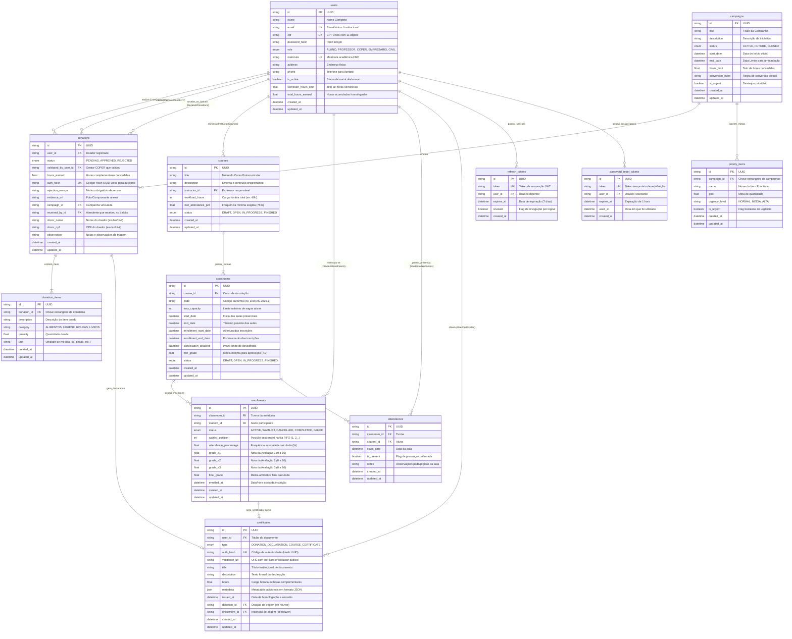

# 04. Arquitetura de Software e Banco de Dados

> [!NOTE]
> Para a visualização detalhada da modelagem orientada a objetos (métodos, tipos e herança) e diagramas de interação dinâmica, consulte também o documento [**07. Diagramas UML do Sistema (`07-diagramas-uml.md`)**](file:///c:/Users/lucas/Downloads/gestaodoacaonovo/documentacao/07-diagramas-uml.md).

---

## 1. Visão Geral da Arquitetura do Sistema

O **Sistema COPER 3.0** adota os princípios da **Clean Architecture** (Arquitetura Limpa) e arquitetura em camadas orientada a serviços no backend, associada a uma Single Page Application (SPA) reativa e desacoplada no frontend.

```mermaid
flowchart TB
    subgraph Cliente["Camada de Apresentação (Frontend)"]
        SPA["React 19 SPA (Vite + Tailwind CSS)"]
        CTX["Contextos (AuthContext)"]
        HTTP["Axios Interceptors (Bearer Token + Auto Refresh)"]
        SPA --> CTX --> HTTP
    end

    subgraph Gateway["Segurança & Roteamento (Express)"]
        SEC["Middlewares de Segurança (Helmet, RateLimit, CORS)"]
        AUTH_MW["Auth Middleware (JWT Verify)"]
        RBAC_MW["RBAC Middleware (Role Verification)"]
        VAL_MW["Validation Middleware (Zod Schemas)"]
    end

    subgraph CamadaAplicacao["Camada de Aplicação & Negócio"]
        CTRL["Controllers (Donation, Classroom, Auth, Certificate)"]
        UC["Casos de Uso (Use Cases)"]
        SVC["Serviços Especializados"]
        PDF_SVC["PDFGeneratorService (PDFKit + QRCode)"]
        MAIL_SVC["MailService (Nodemailer)"]
        NOTIF_SVC["NotificationService (In-App)"]
    end

    subgraph Persistencia["Camada de Infraestrutura & Dados"]
        PRISMA["Prisma ORM 6.4 Client"]
        PG[("PostgreSQL 16 (Relacional + Constraints)")]
    end

    HTTP -->|HTTPS / REST API| SEC
    SEC --> AUTH_MW --> RBAC_MW --> VAL_MW --> CTRL
    CTRL --> UC
    UC --> SVC
    SVC --> PDF_SVC
    SVC --> MAIL_SVC
    SVC --> NOTIF_SVC
    UC --> PRISMA
    PRISMA -->|Connection Pool (pg)| PG
```

---

## 2. Matriz de Controle de Acesso Baseada em Perfis (RBAC)

O sistema implementa 5 perfis de usuário com matriz de autorização estrita:

| Funcionalidade / Recurso | Público / Civil Não Autenticado | ALUNO | PROFESSOR | EMPRESARIO | COPER / ADMIN |
| :--- | :---: | :---: | :---: | :---: | :---: |
| **Visualizar Landing Page & Dados de Impacto** | ✅ | ✅ | ✅ | ✅ | ✅ |
| **Pré-cadastrar Doação Solidária (Sem Login)** | ✅ | — | — | — | — |
| **Validar Autenticidade via QR Code / Hash** | ✅ | ✅ | ✅ | ✅ | ✅ |
| **Login e Auto-Gestão de Perfil** | — | ✅ | ✅ | ✅ | ✅ |
| **Registrar Doação de Aluno no Balcão** | — | ✅ (Solicitação) | — | — | ✅ (Direto) |
| **Homologar / Reprovar Doação e Conceder Horas** | — | ❌ | ❌ | ❌ | ✅ |
| **Consultar Histórico e Saldo de Horas** | — | ✅ (Próprio) | ❌ | ❌ | ✅ (Todos) |
| **Baixar Comprovante Oficial em PDF** | ✅ (via Hash) | ✅ (Modelo 1) | ✅ (Modelo 2) | ✅ (Modelo 2) | ✅ (Todos) |
| **Criar / Editar Campanhas e Itens Prioritários** | — | ❌ | ❌ | ❌ | ✅ |
| **Encerrar Campanha Manualmente** | — | ❌ | ❌ | ❌ | ✅ |
| **Criar Cursos e Abrir Turmas** | — | ❌ | ❌ | ❌ | ✅ |
| **Inscrever-se em Turma (Vaga Ativa / Fila FIFO)** | — | ✅ | ❌ | ❌ | ❌ |
| **Cancelar Inscrição em Curso no Prazo** | — | ✅ (Própria) | ❌ | ❌ | ✅ (Gestão) |
| **Realizar Chamada Online (Diário de Classe)** | — | ❌ | ✅ (Suas Turmas) | ❌ | ✅ (Todas) |
| **Lançar Notas A1, A2 e A3** | — | ❌ | ✅ (Suas Turmas) | ❌ | ✅ (Todas) |
| **Encerrar Turma e Liberar Certificados** | — | ❌ | ✅ (Suas Turmas) | ❌ | ✅ (Todas) |
| **Consultar Relatórios Consolidados de Impacto** | — | ❌ | ❌ | ✅ (Agregado) | ✅ (Analítico) |
| **Barra de Busca Global Multifacetada** | — | ❌ | ❌ | ❌ | ✅ |
| **Gerenciamento de Contas e Ativação de Usuários** | — | ❌ | ❌ | ❌ | ✅ |

---

## 3. Diagrama Entidade-Relacionamento (DER Mermaid)

O modelo relacional foi desenhado diretamente a partir do schema Prisma (`backend/prisma/schema.prisma`):



---

## 4. Dicionário de Dados do Sistema

### 4.1. Tabela `users`
Armazena todos os atores e perfis cadastrados.
- `id` (VARCHAR/UUID, PK): Identificador exclusivo do usuário.
- `name` (VARCHAR, Not Null): Nome completo do usuário.
- `email` (VARCHAR, Unique, Not Null): E-mail de login. Alunos devem utilizar `@aluno.fmpsc.edu.br`.
- `cpf` (VARCHAR, Unique, Not Null): CPF limpo (apenas 11 dígitos numéricos).
- `password_hash` (VARCHAR, Not Null): Hash salgado da senha via bcrypt.
- `role` (ENUM, Default 'CIVIL'): Perfil de acesso (`ALUNO`, `PROFESSOR`, `COPER`, `EMPRESARIO`, `CIVIL`).
- `matricula` (VARCHAR, Unique, Nullable): Código de matrícula acadêmica emitido pela FMP.
- `address` (VARCHAR, Nullable): Endereço residencial (obrigatório para civis em doações).
- `phone` (VARCHAR, Nullable): Telefone de contato.
- `is_active` (BOOLEAN, Default true): Indica regularidade acadêmica do aluno ou status da conta.
- `semester_hours_limit` (FLOAT, Nullable): Limite semestral de horas atribuíveis ao aluno.
- `total_hours_earned` (FLOAT, Default 0): Saldo consolidado de horas complementares deferidas.

### 4.2. Tabela `campaigns`
Gerencia as ações sociais de arrecadação da COPER.
- `id` (VARCHAR/UUID, PK): Identificador da campanha.
- `title` (VARCHAR, Not Null): Nome da campanha.
- `description` (TEXT, Not Null): Detalhes da causa e entidades assistidas.
- `status` (ENUM, Default 'ACTIVE'): Status calculado (`ACTIVE`, `FUTURE`, `CLOSED`).
- `start_date` (TIMESTAMP, Not Null, Default NOW()): Data de início da campanha.
- `end_date` (TIMESTAMP, Nullable): Data limite para término da campanha.
- `hours_limit` (FLOAT, Nullable): Limite máximo de horas concedíveis por doador nesta campanha.
- `conversion_rules` (TEXT, Nullable): Diretriz pública de conversão de materiais em horas.
- `is_urgent` (BOOLEAN, Default false): Flag de prioridade institucional.

### 4.3. Tabela `classrooms`
Armazena as turmas ativas e históricas de cursos extracurriculares.
- `id` (VARCHAR/UUID, PK): Identificador da turma.
- `course_id` (VARCHAR/UUID, FK): Referência ao curso em `courses`.
- `code` (VARCHAR, Nullable): Sigla identificadora (ex: `LIBRAS-2026.1-NOTURNO`).
- `max_capacity` (INTEGER, Not Null): Número máximo de alunos matriculados ativos.
- `start_date` (TIMESTAMP, Not Null): Data da primeira aula.
- `end_date` (TIMESTAMP, Not Null): Data da última aula.
- `enrollment_start_date` (TIMESTAMP, Nullable): Início da janela de inscrições.
- `enrollment_end_date` (TIMESTAMP, Nullable): Término da janela de inscrições.
- `cancellation_deadline` (TIMESTAMP, Nullable): Limite para desistência voluntária do aluno.
- `min_grade` (FLOAT, Default 7.0): Nota mínima exigida para aprovação na turma.
- `status` (ENUM, Default 'OPEN'): Situação da turma (`DRAFT`, `OPEN`, `IN_PROGRESS`, `FINISHED`).

### 4.4. Tabela `enrollments`
Controla a matrícula do aluno, fila de espera e notas.
- `id` (VARCHAR/UUID, PK): Identificador da inscrição.
- `classroom_id` (VARCHAR/UUID, FK): Turma relacionada.
- `student_id` (VARCHAR/UUID, FK): Usuário com perfil `ALUNO`.
- `status` (ENUM, Default 'ACTIVE'): `ACTIVE` (matriculado), `WAITLIST` (fila), `CANCELLED` (desistente), `COMPLETED` (aprovado), `FAILED` (reprovado).
- `waitlist_position` (INTEGER, Nullable): Posição 1, 2, 3... na fila de espera FIFO (nulo se ativo).
- `attendance_percentage` (FLOAT, Nullable): Frequência percentual calculada (0 a 100).
- `grade_a1`, `grade_a2`, `grade_a3` (FLOAT, Nullable): Notas das avaliações formativas (0 a 10).
- `final_grade` (FLOAT, Nullable): Média final calculada $\frac{A_1 + A_2 + A_3}{3}$.
- `enrolled_at` (TIMESTAMP, Default NOW()): Timestamp para garantia da ordem estrita FIFO.

---

## 5. Catálogo de Endpoints da API REST

Todas as rotas são expostas a partir do prefixo `/api` (ou `/api/v1`):

### 5.1. Módulo de Autenticação (`/api/auth`)
| Método | Endpoint | Perfil Permitido | Descrição |
| :--- | :--- | :--- | :--- |
| `POST` | `/api/auth/register` | Público | Cadastro de novos usuários (validação de domínio `@aluno.fmpsc.edu.br` para alunos). |
| `POST` | `/api/auth/login` | Público | Autenticação por e-mail/CPF e senha. Retorna JWT Access Token e dados do usuário. |
| `POST` | `/api/auth/refresh` | Público | Renovação de Access Token via Refresh Token válido. |
| `POST` | `/api/auth/logout` | Autenticado | Revogação de Refresh Token da sessão atual. |
| `GET` | `/api/auth/me` | Autenticado | Retorna o payload completo do perfil logado. |
| `POST` | `/api/auth/forgot-password` | Público | Solicitação de link temporário de redefinição de senha via e-mail. |
| `POST` | `/api/auth/reset-password` | Público | Redefinição efetiva da senha mediante apresentação de token válido. |

### 5.2. Módulo de Campanhas (`/api/campaigns` e `/api/campanhas`)
| Método | Endpoint | Perfil Permitido | Descrição |
| :--- | :--- | :--- | :--- |
| `GET` | `/api/campaigns` | Público / Todos | Lista campanhas cadastradas com status calculado dinamicamente (`ACTIVE`, `FUTURE`, `CLOSED`). |
| `GET` | `/api/campaigns/:id` | Público / Todos | Retorna detalhes de uma campanha, histórico resumido e itens prioritários. |
| `POST` | `/api/campaigns` | `COPER` | Criação de nova campanha com `startDate` e `endDate` obrigatórios/validados. |
| `PUT` | `/api/campaigns/:id` | `COPER` | Atualização de dados da campanha e recalculo do status. |
| `PUT` | `/api/campaigns/:id/encerrar` | `COPER` | Encerramento manual da campanha (status fixado em `CLOSED`). |
| `POST` | `/api/campaigns/:id/items` | `COPER` | Adiciona item prioritário com meta e nível de urgência à campanha. |
| `DELETE`| `/api/campaigns/:id` | `COPER` | Exclusão de campanha. |

### 5.3. Módulo de Doações (`/api/donations` e `/api/doacoes`)
| Método | Endpoint | Perfil Permitido | Descrição |
| :--- | :--- | :--- | :--- |
| `POST` | `/api/donations` | `ALUNO`, `PROFESSOR`, `CIVIL`, `COPER` | Registro de nova doação de materiais com validação de status de campanha ativa. |
| `POST` | `/api/doacoes` (Legacy/Compat) | `ALUNO`, `COPER` | Registro de doação multipart com foto e vínculo de matrícula. |
| `GET` | `/api/donations` | Autenticado | Lista doações com filtros contextuais por perfil (COPER vê todas; Aluno vê as suas). |
| `GET` | `/api/donations/:id` | Autenticado | Retorna detalhes e itens de uma doação específica. |
| `GET` | `/api/donations/:id/pdf` | Autenticado | Download do comprovante de doação em PDF (Modelo 1 para Aluno; Modelo 2 para Civil/Prof). |
| `PATCH`| `/api/donations/:id/validate` | `COPER` | Homologação (`APPROVED`) com horas ou Reprovação (`REJECTED`) com parecer formal. |

### 5.4. Módulo Acadêmico de Cursos e Turmas (`/api/courses` e `/api/classrooms`)
| Método | Endpoint | Perfil Permitido | Descrição |
| :--- | :--- | :--- | :--- |
| `GET` | `/api/courses` | Autenticado | Lista cursos extracurriculares ofertados pela faculdade. |
| `POST` | `/api/courses` | `COPER` | Cadastra novo curso extracurricular e vincula professor titular. |
| `GET` | `/api/classrooms` | Autenticado | Lista turmas com indicador de vagas ativas e contagem de fila de espera. |
| `POST` | `/api/classrooms` | `COPER` | Abre nova turma definindo capacidade, prazos de inscrição e cancelamento. |
| `GET` | `/api/classrooms/teaching/my` | `PROFESSOR`, `COPER` | Lista turmas ministradas pelo professor logado para acesso ao Diário de Classe. |
| `GET` | `/api/classrooms/:id/waitlist`| `COPER` | Consulta a fila de espera ordenada em tempo real da turma. |
| `POST` | `/api/classrooms/:id/enroll` | `ALUNO` | Inscrição do aluno com algoritmo FIFO (vaga imediata ou posição na fila). |
| `POST` | `/api/classrooms/:id/cancel` | `ALUNO` | Desistência da vaga e promoção atômica do 1º colocado da fila de espera. |
| `PATCH`| `/api/classrooms/:id/grades` | `PROFESSOR`, `COPER` | Lançamento em lote das notas A1, A2 e A3 dos alunos matriculados. |
| `POST` | `/api/classrooms/:id/close` | `PROFESSOR`, `COPER` | Encerramento da turma, cálculo da média final e emissão dos certificados (Modelo 3). |

### 5.5. Frequência e Diário de Classe (`/api/attendances`)
| Método | Endpoint | Perfil Permitido | Descrição |
| :--- | :--- | :--- | :--- |
| `POST` | `/api/attendances` | `PROFESSOR`, `COPER` | Registro de chamada presencial por data de aula e recálculo de porcentagem de faltas. |
| `GET` | `/api/attendances/classroom/:id`| `PROFESSOR`, `COPER` | Histórico consolidado de chamadas e mapa de presença dos alunos. |

### 5.6. Certificados e Auditoria Pública (`/api/certificates` e `/api/public`)
| Método | Endpoint | Perfil Permitido | Descrição |
| :--- | :--- | :--- | :--- |
| `GET` | `/api/public/validar/:code` | Público | Consulta pública do hash para atestar a autenticidade de comprovantes e diplomas. |
| `GET` | `/api/public/stats` | Público | Estatísticas públicas de impacto social, total de itens, alunos e cursos ativos. |
| `POST` | `/api/public/doacoes/anonima`| Público / Civil | Pré-cadastro de doação para civis e comunidade externa sem login. |
| `GET` | `/api/certificates/:id/pdf` | Público | Download do documento oficial em PDF gerado em tempo de execução via PDFKit. |
| `GET` | `/api/certificates` | Autenticado | Lista certificados emitidos para o usuário ou relatório geral para COPER. |

### 5.7. Relatórios e Busca Global (`/api/reports` e `/api/search`)
| Método | Endpoint | Perfil Permitido | Descrição |
| :--- | :--- | :--- | :--- |
| `GET` | `/api/reports/consolidated` | `COPER`, `EMPRESARIO` | Relatórios consolidados por campanha/data (trava de até 1 ano e retenção de 2 anos). |
| `GET` | `/api/reports/export` | `COPER`, `EMPRESARIO` | Exportação de dados estruturados para prestação de contas sociais e balanço ESG. |
| `GET` | `/api/search` | `COPER` | Pesquisa global instantânea por aluno, matrícula, campanha ou hash de doação. |
