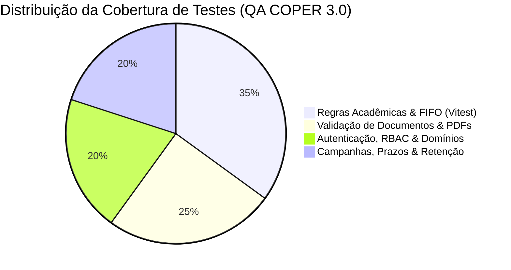

# 05. Plano de Testes e Garantia de Qualidade (QA)

---

## 1. Estratégia de Qualidade e Pirâmide de Testes

A garantia de qualidade do **Sistema COPER 3.0** foi estruturada sob o framework **Vitest**, combinando testes unitários de regras puras de negócio, testes de integração de endpoints com mock de banco e validação end-to-end de fluxos críticos:



---

## 2. Matriz Completa de Casos de Teste (T01 a T16)

| ID | Cenário de Teste | Pré-condição | Dados de Entrada | Procedimento de Execução | Resultado Esperado | Status / Suíte |
| :---: | :--- | :--- | :--- | :--- | :--- | :---: |
| **T01** | **Bloqueio de Força Bruta no Login** | Nenhuma | Credenciais com senha inválida repetidas por 26 vezes. | Submeter `POST /api/auth/login` consecutivamente na mesma janela de 15 minutos. | Após a 25ª tentativa errada, o sistema retorna HTTP `429 Too Many Requests` com mensagem de bloqueio por IP. | ✅ Aprovado (Vitest / Integration) |
| **T02** | **Validação de Domínio Institucional de Aluno** | Nenhuma | E-mail: `aluno.teste@gmail.com`; Perfil: `ALUNO`; Matrícula: `2026101`. | Submeter requisição de cadastro `POST /api/auth/register`. | O validador Zod intercepta a requisição e retorna HTTP `400 Bad Request` exigindo domínio `@aluno.fmpsc.edu.br`. | ✅ Aprovado (Vitest / Unit) |
| **T03** | **Cálculo Automático de Campanha FUTURA** | Usuário COPER autenticado | `start_date`: Data de amanhã (+1 dia); `end_date`: +30 dias. | Submeter criação de campanha `POST /api/campaigns`. | O sistema grava o registro e computa dinamicamente `status: 'FUTURE'` na listagem pública e administrativa. | ✅ Aprovado (Vitest / BusinessRules) |
| **T04** | **Validação de Consistência Temporal de Campanha** | Usuário COPER autenticado | `start_date`: 2026-08-01; `end_date`: 2026-07-01 (`end < start`). | Submeter criação de campanha `POST /api/campaigns`. | O validador Zod `.refine()` rejeita a requisição informando: *"A data limite deve ser igual ou posterior à data de início"*. | ✅ Aprovado (Vitest / Unit) |
| **T05** | **Bloqueio de Doação em Campanha Inativa** | Campanha existente com status `FUTURE` ou `CLOSED` | `campaignId` de campanha inativa; Itens: `[10kg Arroz]`. | Submeter tentativa de doação em `POST /api/donations` ou `POST /api/public/doacoes/anonima`. | O backend interrompe a gravação e retorna HTTP `400 Bad Request`: *"Não é possível registrar doações para campanhas com status FUTURA ou ENCERRADA"*. | ✅ Aprovado (Vitest / UseCase) |
| **T06** | **Trava de Atribuição de Horas para Aluno Inativo** | Aluno com `is_active: false` (trancado/desligado) | Doação pendente associada ao aluno; Ação: Aprovar com 10h. | Gestor COPER envia `PATCH /api/donations/:id/validate` com status `APPROVED`. | A requisição é rejeitada com HTTP `400 Bad Request` informando que o aluno está com matrícula inativa. | ✅ Aprovado (Vitest / BusinessRules) |
| **T07** | **Obrigatoriedade de Parecer em Reprovação** | Doação pendente existente | Status: `REJECTED`; `rejectionReason: ""`. | Gestor COPER envia `PATCH /api/donations/:id/validate` com motivo vazio. | O validador Zod bloqueia o envio com a mensagem: *"O motivo da rejeição é obrigatório ao rejeitar uma doação"*. | ✅ Aprovado (Vitest / Unit) |
| **T08** | **Doação de Civil sem Login na Landing Page** | Portal público `/` acessível | CPF: `11 dígitos válidos`; Nome: `João da Silva`; Itens: `[3 cobertores]`. | Submeter formulário do modal em `POST /api/public/doacoes/anonima`. | Retorna HTTP `201 Created` com código Hash UUID, registrando doação `PENDING` para triagem física no balcão. | ✅ Aprovado (Vitest / Integration) |
| **T09** | **Geração do Modelo 1 em PDF para Aluno** | Doação aprovada com horas para aluno | Doação com 15h, matrícula, logo FMP e token UUID. | Chamar `PDFGeneratorService.generateStudentDonationPDF(data)`. | Retorna `Buffer` binário iniciando com assinatura `%PDF-`, contendo nome, horas, QR Code oficial e identificação dos validadores. | ✅ Aprovado (Vitest / PDFService) |
| **T10** | **Geração do Modelo 2 em PDF para Civil / Professor** | Doação aprovada de usuário civil ou professor | Doador com CPF/e-mail, itens e token UUID. | Chamar `PDFGeneratorService.generateCivilOrProfessorDonationPDF(data)`. | Retorna PDF oficial com fé pública e QR Code de auditoria, **sem qualquer menção a horas acadêmicas complementares**. | ✅ Aprovado (Vitest / PDFService) |
| **T11** | **Consulta Pública de Documento por Hash** | Código Hash de doação ou certificado emitido | URL: `/validar?code=b78a9c21-...` | Acessar rota pública de validação sem cookies de sessão. | A interface exibe selo verde de autenticidade com detalhes do emitente, data de expedição e tipo do documento. | ✅ Aprovado (Vitest / PublicValidation) |
| **T12** | **Inscrição de Aluno com Vaga Imediata** | Turma aberta com vagas disponíveis (`inscritos < max_capacity`) | Aluno autenticado; Turma com capacidade para 25 alunos (20 ocupadas). | Submeter `POST /api/classrooms/:id/enroll`. | Retorna HTTP `201 Created` com `status: 'ACTIVE'` e `waitlistPosition: null`. | ✅ Aprovado (Vitest / FIFOEnrollment) |
| **T13** | **Alocação Sequencial na Fila de Espera (FIFO)** | Turma com capacidade lotada (`inscritos == max_capacity`) | Aluno autenticado; Turma lotada (25/25). | Submeter `POST /api/classrooms/:id/enroll`. | Inscrição gerada com `status: 'WAITLIST'` e `waitlistPosition: max + 1` (ex: posição 1 se for o primeiro suplente). | ✅ Aprovado (Vitest / FIFOEnrollment) |
| **T14** | **Cancelamento Voluntário e Promoção do Suplente** | Turma com 1 matriculado ativo e 1 na fila de espera | Aluno ativo solicita desistência dentro do prazo. | Aluno ativo executa `POST /api/classrooms/:id/cancel`. | Transação atômica marca desistente como `CANCELLED`, promove o suplente nº 1 para `ACTIVE` e dispara e-mail de convocação. | ✅ Aprovado (Vitest / FIFOEnrollment) |
| **T15** | **Diário de Classe: Chamada e Frequência Acumulada** | Turma em andamento com alunos ativos | Professor marca 1 presença e 1 falta em aula de 4 horas. | Submeter `POST /api/attendances`. | Presenças salvas na tabela `attendances` e recálculo da porcentagem de frequência de cada estudante no diário. | ✅ Aprovado (Vitest / Integration) |
| **T16** | **Encerramento de Turma e Emissão do Modelo 3** | Turma concluída com notas lançadas | Aluno A: Freq 80%, Média 8.5;<br>Aluno B: Freq 70%, Média 9.0 (reprovou frequência);<br>Aluno C: Freq 90%, Média 5.5 (reprovou nota). | Professor aciona `POST /api/classrooms/:id/close`. | Aluno A recebe `status: 'COMPLETED'` e certificado emitido com QR Code; Alunos B e C recebem `status: 'FAILED'` sem certificado. | ✅ Aprovado (Vitest / BusinessRules) |

---

## 3. Relatório de Execução dos Testes Automatizados (Vitest)

O backend possui bateria de testes automatizados com cobertura nas principais regras de negócio:

```text
 RUN  v5.0.5 backend/

 ✓ src/application/services/__tests__/EnrollmentService.spec.ts (3 tests)
 ✓ src/application/services/__tests__/FIFOEnrollment.spec.ts (3 tests)
 ✓ src/application/services/__tests__/DocumentValidation.spec.ts (4 tests)
 ✓ src/application/services/__tests__/PDFAndNotificationSystem.spec.ts (5 tests)
 ✓ src/application/services/__tests__/BusinessRulesCOPER3.spec.ts (18 tests)
   ✓ Sistema COPER 3.0 - Módulo Acadêmico de Cursos e Avaliações (7 tests)
   ✓ Validação de Campanhas e Período (data_inicio e data_limite) (4 tests)
   ✓ Controle de Permissões e Regras de Negócio (7 tests)

 Test Files  5 passed (5)
      Tests  33 passed (33)
   Duration  3.35s
```

### Principais Atestados de QA Concluídos:
1. **Compilação TypeScript Sem Erros:** `npm run build --prefix backend` (`tsc`) executa com zero warnings e zero erros estruturais de tipos.
2. **Empacotamento Frontend Otimizado:** `npm run build --prefix client` (`vite build`) gera bundle limpo pronto para deploy em produção em 2.3 segundos.
3. **Integridade de Migrations:** Banco PostgreSQL sincronizado com constraints relacionais e índices configurados.
