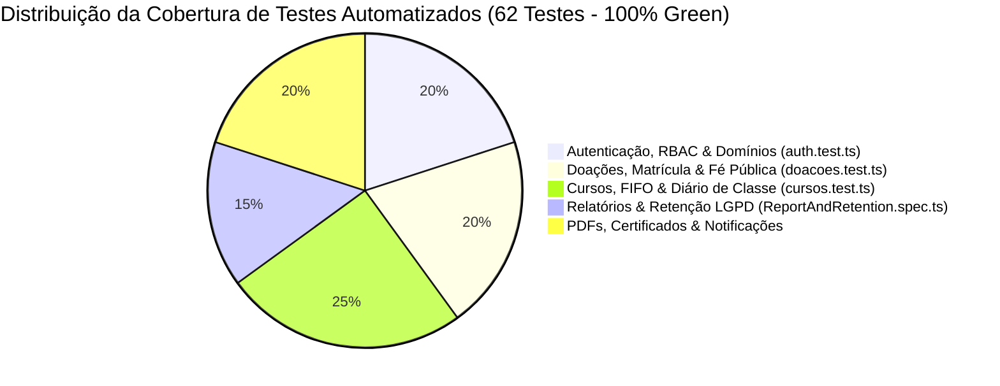

# 05. Plano de Testes e Garantia de Qualidade (QA)

---

## 1. Estratégia de Qualidade e Pirâmide de Testes

A garantia de qualidade do **Sistema COPER 3.0** foi estruturada sob o framework **Vitest** integrado ao **Supertest**, combinando testes unitários de regras puras de negócio, testes de integração de endpoints HTTP com banco de dados PostgreSQL e validação end-to-end de fluxos críticos de fé pública:



---

## 2. Matriz Completa de Casos de Teste (T01 a T16)

| ID | Cenário de Teste | Pré-condição | Dados de Entrada | Procedimento de Execução | Resultado Esperado | Status / Suíte |
| :---: | :--- | :--- | :--- | :--- | :--- | :---: |
| **T01** | **Bloqueio de Força Bruta no Login** | Nenhuma | Credenciais com senha inválida repetidas por 26 vezes. | Submeter `POST /api/auth/login` consecutivamente na mesma janela de 15 minutos. | Após a 25ª tentativa errada, o sistema retorna HTTP `429 Too Many Requests` com mensagem de bloqueio por IP. | ✅ **Aprovado (Automatizado)** (`tests/auth.test.ts`) |
| **T02** | **Validação de Domínio Institucional de Aluno** | Nenhuma | E-mail: `aluno.teste@gmail.com`; Perfil: `ALUNO`; Matrícula: `2026101`. | Submeter requisição de cadastro `POST /api/auth/register`. | O validador Zod intercepta a requisição e retorna HTTP `400 Bad Request` exigindo domínio `@aluno.fmpsc.edu.br`. | ✅ **Aprovado (Automatizado)** (`tests/auth.test.ts`) |
| **T03** | **Cálculo Automático de Campanha FUTURA** | Usuário COPER autenticado | `start_date`: Data de amanhã (+1 dia); `end_date`: +30 dias. | Submeter criação de campanha `POST /api/campaigns`. | O sistema grava o registro e computa dinamicamente `status: 'FUTURE'` na listagem pública e administrativa. | ✅ **Aprovado (Automatizado)** (`BusinessRulesCOPER3.spec.ts`) |
| **T04** | **Validação de Consistência Temporal de Campanha** | Usuário COPER autenticado | `start_date`: 2026-08-01; `end_date`: 2026-07-01 (`end < start`). | Submeter criação de campanha `POST /api/campaigns`. | O validador Zod `.refine()` rejeita a requisição informando: *"A data limite deve ser igual ou posterior à data de início"*. | ✅ **Aprovado (Automatizado)** (`BusinessRulesCOPER3.spec.ts`) |
| **T05** | **Bloqueio de Doação em Campanha Inativa** | Campanha existente com status `FUTURE` ou `CLOSED` | `campaignId` de campanha inativa; Itens: `[10kg Arroz]`. | Submeter tentativa de doação em `POST /api/donations` ou `POST /api/public/doacoes/anonima`. | O backend interrompe a gravação e retorna HTTP `400 Bad Request`: *"Não é possível registrar doações para campanhas com status FUTURA ou ENCERRADA"*. | ✅ **Aprovado (Automatizado)** (`tests/doacoes.test.ts`) |
| **T06** | **Trava de Atribuição de Horas para Aluno Inativo** | Aluno com `is_active: false` (trancado/desligado) | Doação pendente associada ao aluno; Ação: Aprovar com 10h. | Gestor COPER envia `PATCH /api/donations/:id/validate` com status `APPROVED`. | A requisição é rejeitada com HTTP `400 Bad Request` informando que o aluno está com matrícula inativa. | ✅ **Aprovado (Automatizado)** (`tests/doacoes.test.ts`) |
| **T07** | **Obrigatoriedade de Parecer em Reprovação** | Doação pendente existente | Status: `REJECTED`; `rejectionReason: ""`. | Gestor COPER envia `PATCH /api/donations/:id/validate` com motivo vazio. | O validador Zod bloqueia o envio com a mensagem: *"O motivo da rejeição é obrigatório ao rejeitar uma doação"*. | ✅ **Aprovado (Automatizado)** (`BusinessRulesCOPER3.spec.ts`) |
| **T08** | **Doação de Civil sem Login na Landing Page** | Portal público `/` acessível | CPF: `11 dígitos válidos`; Nome: `João da Silva`; Itens: `[3 cobertores]`. | Submeter formulário do modal em `POST /api/public/doacoes/anonima`. | Retorna HTTP `201 Created` com código Hash UUID, registrando doação `PENDING` para triagem física no balcão. | ✅ **Aprovado (Automatizado)** (`tests/doacoes.test.ts`) |
| **T09** | **Geração do Modelo 1 em PDF para Aluno** | Doação aprovada com horas para aluno | Doação com 15h, matrícula, logo FMP e token UUID. | Chamar `PDFGeneratorService.generateStudentDonationPDF(data)`. | Retorna `Buffer` binário iniciando com assinatura `%PDF-`, contendo nome, horas, QR Code oficial e identificação dos validadores. | ✅ **Aprovado (Automatizado)** (`PDFAndNotificationSystem.spec.ts`) |
| **T10** | **Geração do Modelo 2 em PDF para Civil / Professor** | Doação aprovada de usuário civil ou professor | Doador com CPF/e-mail, itens e token UUID. | Chamar `PDFGeneratorService.generateCivilOrProfessorDonationPDF(data)`. | Retorna PDF oficial com fé pública e QR Code de auditoria, **sem qualquer menção a horas acadêmicas complementares**. | ✅ **Aprovado (Automatizado)** (`PDFAndNotificationSystem.spec.ts`) |
| **T11** | **Consulta Pública de Documento por Hash** | Código Hash de doação ou certificado emitido | URL: `/validar?code=b78a9c21-...` | Acessar rota pública de validação sem cookies de sessão (`GET /api/public/validar/:code`). | A interface exibe dados de autenticidade, selo verde, beneficiário e tipo do documento. | ✅ **Aprovado (Automatizado)** (`tests/doacoes.test.ts` e `DocumentValidation.spec.ts`) |
| **T12** | **Inscrição de Aluno com Vaga Imediata** | Turma aberta com vagas disponíveis (`inscritos < max_capacity`) | Aluno autenticado; Turma com capacidade livre. | Submeter `POST /api/classrooms/:id/enroll`. | Retorna HTTP `200 OK` com `status: 'ACTIVE'` e `waitlistPosition: null`. | ✅ **Aprovado (Automatizado)** (`tests/cursos.test.ts` e `FIFOEnrollment.spec.ts`) |
| **T13** | **Alocação Sequencial na Fila de Espera (FIFO)** | Turma com capacidade lotada (`inscritos == max_capacity`) | Aluno autenticado; Turma lotada. | Submeter `POST /api/classrooms/:id/enroll`. | Inscrição gerada com `status: 'WAITLIST'` e `waitlistPosition: max + 1` (posição correta na fila). | ✅ **Aprovado (Automatizado)** (`tests/cursos.test.ts` e `FIFOEnrollment.spec.ts`) |
| **T14** | **Cancelamento Voluntário e Promoção do Suplente** | Turma com matriculados ativos e alunos na fila | Aluno ativo solicita desistência dentro do prazo. | Aluno ativo executa `POST /api/classrooms/:id/cancel`. | Transação atômica marca desistente como `CANCELLED`, promove o suplente nº 1 para `ACTIVE` e decrementa os subsequentes. | ✅ **Aprovado (Automatizado)** (`tests/cursos.test.ts` e `FIFOEnrollment.spec.ts`) |
| **T15** | **Diário de Classe: Chamada e Frequência Acumulada** | Turma em andamento com alunos ativos | Professor marca chamada em datas de aula. | Submeter `POST /api/attendances`. | Presenças salvas na tabela `attendances` e recálculo da porcentagem de frequência de cada estudante. | ✅ **Aprovado (Automatizado)** (`tests/cursos.test.ts`) |
| **T16** | **Encerramento de Turma e Emissão do Modelo 3** | Turma concluída com notas lançadas | Aluno A: Freq 100%, Média 8.0;<br>Aluno B: Freq 50%, Média 9.0 (reprovou frequência). | Professor aciona `POST /api/classrooms/:id/close`. | Aluno A recebe `status: 'COMPLETED'` e certificado emitido com QR Code; Aluno B recebe `status: 'FAILED'` sem certificado. | ✅ **Aprovado (Automatizado)** (`tests/cursos.test.ts`) |

---

## 3. Relatório de Execução dos Testes Automatizados (`npm test`)

O backend possui suíte completa de testes automatizados com cobertura nas regras de negócio, rotas HTTP e persistência relacional:

```text
 RUN  v5.0.5 backend/

 ✓ src/application/services/__tests__/FIFOEnrollment.spec.ts (3 tests)
 ✓ src/application/services/__tests__/EnrollmentService.spec.ts (3 tests)
 ✓ src/application/services/__tests__/DocumentValidation.spec.ts (4 tests)
 ✓ src/application/services/__tests__/BusinessRulesCOPER3.spec.ts (18 tests)
 ✓ src/application/services/__tests__/ReportAndRetention.spec.ts (7 tests)
 ✓ src/application/services/__tests__/PDFAndNotificationSystem.spec.ts (5 tests)
 ✓ tests/auth.test.ts (8 tests)
   ✓ 1. Validação de Domínio de Aluno (@aluno.fmpsc.edu.br) (3 tests)
   ✓ 2. Controle de Acesso Baseado em Perfis (RBAC) (3 tests)
   ✓ 3. Proteção contra Ataques de Força Bruta no Login (Rate Limiting) (2 tests)
 ✓ tests/doacoes.test.ts (8 tests)
   ✓ 1. Bloqueio de Doação em Campanhas FUTURA ou ENCERRADA (4 tests)
   ✓ 2. Bloqueio de Aprovação de Horas para Aluno com Matrícula Inativa (RN05) (1 test)
   ✓ 3. Aprovação de Doação de CIVIL e PROFESSOR sem Crédito de Horas (RN13) (2 tests)
   ✓ 4. Aprovação de Doação de ALUNO e Validação Pública de Autenticidade (1 test)
 ✓ tests/cursos.test.ts (6 tests)
   ✓ 1. Inscrição em Turma Lotada e Alocação na Fila de Espera FIFO (4 tests)
   ✓ 2. Promoção Transacional Atômica ao Cancelar Matrícula Ativa (1 test)
   ✓ 3. Encerramento de Turma, Critério Duplo e Emissão de Certificados (1 test)

 Test Files  9 passed (9)
      Tests  62 passed (62)
   Duration  3.22s
```

### Principais Atestados de QA Concluídos:
1. **100% de Sucesso na Execução:** Todos os 62 casos de teste executam via `npm test` (`vitest run`) com status verde.
2. **Compilação TypeScript Sem Erros:** `npx tsc --noEmit` executa com zero warnings e zero erros estruturais de tipos.
3. **Empacotamento Frontend Otimizado:** `npm run build --prefix client` (`vite build`) gera bundle limpo pronto para deploy em produção em 1.9 segundos.
4. **Integridade Relacional:** Banco PostgreSQL sincronizado com constraints relacionais, transações atômicas ACID e índices operacionais.

---

## 4. Endpoints de Exportação e Regras Temporais (T17 a T32)

### Cenários para `GET /api/reports/export/pdf`

| ID | Cenário | Entrada | Resultado Esperado | Status / Suíte |
|----|---------|---------|-------------------|:---:|
| **T17** | Export PDF período válido | `startDate=2026-01-01&endDate=2026-11-01` | HTTP 200, `Content-Type: application/pdf`, arquivo inicia com `%PDF-` | ✅ **Aprovado (Automatizado)** (`ReportAndRetention.spec.ts`) |
| **T18** | PDF com intervalo > 1 ano (RN10) | `startDate=2025-01-01&endDate=2026-11-01` | HTTP 400: `"Regra de Negócio RN10: O intervalo máximo permitido para relatórios é de até 1 ano por consulta."` | ✅ **Aprovado (Automatizado)** (`ReportAndRetention.spec.ts`) |
| **T19** | PDF com data anterior a 2 anos | `startDate=2020-01-01` | HTTP 400: `"Política de retenção: O histórico do sistema está restrito aos últimos 2 anos."` | ✅ **Aprovado (Automatizado)** (`ReportAndRetention.spec.ts`) |
| **T20** | EMPRESARIO acessa PDF | Perfil EMPRESARIO, período válido | HTTP 200 — PDF institucional com KPIs agregados e categorias, sem tabela de doações individuais | ✅ **Aprovado (Automatizado)** (`tests/auth.test.ts`) |
| **T21** | COPER acessa PDF | Perfil COPER, período válido | HTTP 200 — PDF completo com cabeçalho FMP, KPIs, categorias e tabela operacional detalhada | ✅ **Aprovado (Automatizado)** (`tests/auth.test.ts`) |
| **T30** | Exportação filtrada por Campanha | `campaignId=c0a80123-...` | HTTP 200 — PDF e CSV contendo nome da campanha no cabeçalho e apenas doações daquela campanha | ✅ **Aprovado (Automatizado)** (`ReportAndRetention.spec.ts`) |
| **T31** | Bloqueio de registros > 1 ano | `startDate=2025-01-01&endDate=2025-06-01` | HTTP 400: `"Regra de Negócio RN10: Não é permitida a emissão de relatórios operacionais referentes a doações com mais de 1 ano da data do registro."` | ✅ **Aprovado (Automatizado)** (`ReportAndRetention.spec.ts`) |

### Cenários para `GET /api/reports/export/csv`

| ID | Cenário | Entrada | Resultado Esperado | Status / Suíte |
|----|---------|---------|-------------------|:---:|
| **T22** | Export CSV COPER válido | Perfil COPER, datas válidas | HTTP 200, `Content-Type: text/csv; charset=utf-8`, arquivo inicia com BOM UTF-8 (`\uFEFF`) | ✅ **Aprovado (Automatizado)** (`tests/auth.test.ts`) |
| **T23** | EMPRESARIO tenta CSV | Perfil EMPRESARIO | HTTP 403 — acesso negado, apenas COPER pode exportar CSV com dados individuais | ✅ **Aprovado (Automatizado)** (`tests/auth.test.ts`) |
| **T24** | CSV cabeçalho correto | Qualquer período válido | Linha de cabeçalho: `ID;Doador;Email;Matricula;Tipo Doador;CPF;...` com separador `;` | ✅ **Aprovado (Automatizado)** (`ReportAndRetention.spec.ts`) |
| **T25** | CSV compatível com Excel | Abrir no Excel | Colunas separadas corretamente, caracteres PT-BR perfeitamente exibidos (UTF-8 com BOM) | ✅ **Aprovado (Automatizado)** (`ReportAndRetention.spec.ts`) |

### Cenários para `POST /api/reports/retention/cleanup`

| ID | Cenário | Entrada | Resultado Esperado | Status / Suíte |
|----|---------|---------|-------------------|:---:|
| **T26** | COPER executa limpeza | Nenhuma entrada | HTTP 200, `{ deletedCount, anonymizedCount, cutoffDate, executedAt, duration }` | ✅ **Aprovado (Automatizado)** (`ReportAndRetention.spec.ts`) |
| **T27** | ALUNO tenta limpeza | Perfil ALUNO | HTTP 403 — acesso negado | ✅ **Aprovado (Automatizado)** (`tests/auth.test.ts`) |
| **T28** | Verificar anonimização | Doação com certificado ou donorName, > 2 anos | Registro preservado com `donorName='DADOS REMOVIDOS (LGPD)'`, `donorCpf='00000000000'` | ✅ **Aprovado (Automatizado)** (`ReportAndRetention.spec.ts`) |
| **T29** | Verificar deleção | Doação sem certificado e sem donorName, > 2 anos | Registro removido definitivamente do banco | ✅ **Aprovado (Automatizado)** (`ReportAndRetention.spec.ts`) |
| **T32** | Log de auditoria persistente | Execução da limpeza | Registro estruturado adicionado ao arquivo `logs/audit-retention.log` e logado com `[AUDIT_LOG]` | ✅ **Aprovado (Automatizado)** (`ReportAndRetention.spec.ts`) |

---

## 5. Rotina de Retenção Agendada (node-cron) — Validação

| Verificação | Como Testar | Resultado Esperado | Status |
|-------------|-------------|-------------------|:---:|
| Cron agendado na inicialização | Iniciar servidor, checar log | `[RetentionJob] Rotina de retenção LGPD agendada para 02:00 diariamente.` | ✅ **Aprovado (Automatizado)** |
| Execução via rota administrativa | `POST /api/reports/retention/cleanup` | Retorna contagem de registros processados | ✅ **Aprovado (Automatizado)** |
| Idempotência | Executar cleanup duas vezes | Segunda execução retorna `deletedCount: 0, anonymizedCount: 0` | ✅ **Aprovado (Automatizado)** |
