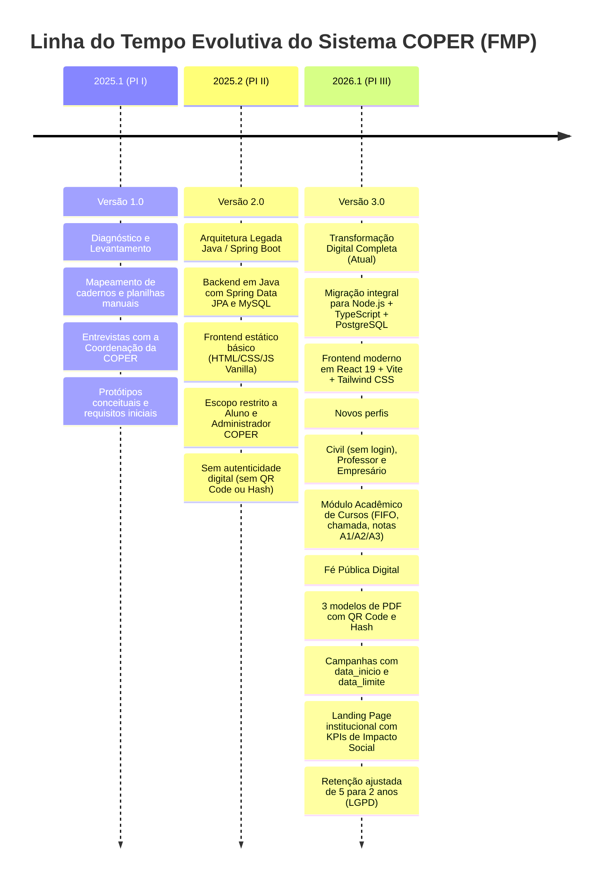

# 06. Histórico de Versões e Changelog do Projeto

---

## 1. Linha do Tempo e Evolução Acadêmica

O desenvolvimento do **Sistema COPER** percorreu três ciclos evolutivos na grade curricular do curso de Tecnologia em Análise e Desenvolvimento de Sistemas (ADS) da Faculdade Municipal de Palhoça (FMP):

---

## 2. Detalhamento das Versões

### 2.1. Versão 1.0 (Concepção Inicial e Diagnóstico)
- **Contexto:** Projeto Integrador I.
- **Objetivo:** Compreender a rotina de trabalho da Coordenação de Extensão e Responsabilidade Social (COPER).
- **Entregáveis:**
  - Especificação preliminar de requisitos funcionais e diagramas de fluxo de trabalho.
  - Levantamento dos formulários em papel utilizados na recepção de alimentos e roupas.
  - Constatação dos gargalos: perda de recibos, acúmulo de papéis e falta de transparência nas horas complementares.

---

### 2.2. Versão 2.0 (Projeto Integrador II — Arquitetura Legada Java)
- **Contexto:** Projeto Integrador II.
- **Stack:** Java 17, Spring Boot 3, Spring Data JPA, MySQL 8, Thymeleaf / HTML/CSS Vanilla.
- **Características e Limitações:**
  - Sistema restrito aos perfis `Aluno` e `Admin (COPER)`.
  - Controle estritamente focado em recebimento de doações de alunos no balcão.
  - Política de retenção inicial de **5 anos** sem mecanismo automático de expurgo.
  - Inexistência de módulo de cursos extracurriculares (oficinas e chamadas continuavam em Google Forms e planilhas).
  - Comprovantes sem código verificador criptográfico ou QR Code.
  - Ausência de página pública ou canal de participação para a comunidade civil.

---

### 2.3. Versão 3.0 (Projeto Integrador III — Versão Atual em Produção)
- **Contexto:** Projeto Integrador III (4ª Fase ADS - FMP).
- **Stack Moderna:** Node.js 22 LTS, Express.js, TypeScript 5.8, Prisma ORM 6.4, PostgreSQL 16, React 19, Vite, Tailwind CSS 4, PDFKit, node-qrcode, Nodemailer, Vitest.
- **Principais Inovações e Recursos Implementados:**
  1. **Migração Tecnológica Completa:** Descontinuação do ecossistema Java/MySQL em favor da arquitetura em TypeScript de ponta a ponta, proporcionando maior velocidade de desenvolvimento e tipagem compartilhada entre frontend e backend.
  2. **Expansão para 5 Perfis de Usuário (RBAC):**
     - `ALUNO`: Cadastro restrito a `@aluno.fmpsc.edu.br` e matrícula; único que acumula horas.
     - `PROFESSOR`: Acesso ao Diário de Classe Digital de cursos e turmas.
     - `COPER`: Controle gerencial completo da plataforma.
     - `CIVIL`: Possibilidade de doar solidariamente pela Landing Page **sem login**, recebendo comprovante auditável.
     - `EMPRESARIO`: Visualização de relatórios consolidados e métricas de impacto social para balanços ESG.
  3. **Módulo Acadêmico de Cursos e Oficinas (ex: Libras):**
     - Cadastro de cursos, carga horária e instrutores vinculados.
     - Turmas com controle de capacidade máxima e **Fila de Espera Automática (FIFO)**.
     - Transação atômica que promove imediatamente o 1º colocado da fila em caso de desistência dentro do prazo.
     - **Diário de Classe Digital** com chamada online aula a aula e porcentagem acumulada de faltas.
     - Lançamento de notas formativas **$A_1$, $A_2$ e $A_3$** (critério de aprovação: $\text{frequência} \ge 75\%$ e $\text{média} \ge 7.0$).
  4. **Fé Pública e Emissão Digital (Modelo Unisul / FMP):**
     - Motor `PDFGeneratorService` que emite 3 modelos distintos de documentos com selo vetorial institucional:
       - **Modelo 1:** Comprovante de Doação com Horas Complementares para Aluno;
       - **Modelo 2:** Comprovante de Doação Solidária sem Horas para Civil e Professor;
       - **Modelo 3:** Certificado de Conclusão de Curso Extracurricular (Diploma em Paisagem).
     - Todos os documentos trazem **QR Code dinâmico** e **Código Hash UUIDv4 único**.
     - Página pública `/validar?code=HASH` permitindo auditoria por qualquer pessoa sem autenticação.
  5. **Ciclo de Vida de Campanhas (`data_inicio` e `data_limite`):**
     - Campo obrigatório de data de início (`start_date`) e data limite (`end_date`).
     - Cálculo de status automático em tempo de execução: `FUTURA`, `ATIVA` ou `ENCERRADA`.
     - Trava sistêmica que bloqueia doações em campanhas futuras ou encerradas.
  6. **Landing Page Institucional (`/`):**
     - Apresentação pública da COPER e da FMP com Dark Mode elegante em azul profundo e ciano/teal.
     - Métricas dinâmicas via endpoint `/api/public/stats` (horas doadas, famílias assistidas, turmas ativas).
     - Vitrine de campanhas e cursos extracurriculares.
  7. **Governança e LGPD:**
     - Ajuste formal da política de retenção para **2 anos**.
     - Limite de consultas consolidadas para intervalos de até **1 ano**.

---

## 3. Matriz Comparativa Evolutiva

| Critério / Funcionalidade | Versão 1.0 (Concepção) | Versão 2.0 (Legado Java) | Versão 3.0 (Atual Node/React) |
| :--- | :---: | :---: | :---: |
| **Backend Runtime** | Manual / Papel | Java 17 (Spring Boot) | Node.js 22 LTS (TypeScript) |
| **Banco de Dados** | Inexistente (Planilhas) | MySQL 8 | PostgreSQL 16 + Prisma ORM |
| **Frontend** | Papel / Forms | HTML / CSS Vanilla | React 19 + Vite + Tailwind CSS |
| **Perfis Atendidos** | Apenas Balcão | Aluno e COPER | Aluno, Professor, COPER, Empresário e Civil |
| **Validação de E-mail de Aluno** | Manual | Não implementada | Estrita (`@aluno.fmpsc.edu.br`) |
| **Doação sem Login (Civil)** | ❌ Não | ❌ Não | ✅ Sim (Landing Page + Hash) |
| **Datas da Campanha** | Apenas data final | Apenas data limite manual | `data_inicio` e `data_limite` (Status Automático) |
| **Travas de Status de Campanha** | ❌ Não | ❌ Não | ✅ Sim (Bloqueia Futura/Encerrada) |
| **Módulo de Cursos (ex: Libras)** | ❌ Não (Google Forms) | ❌ Não | ✅ Sim (Completo e Integrado) |
| **Fila de Espera FIFO** | ❌ Não | ❌ Não | ✅ Sim (Algoritmo Automático) |
| **Diário de Classe & Chamada** | Folhas avulsas | ❌ Não | ✅ Sim (Chamada Online + Frequência %) |
| **Avaliações Formatizadas** | ❌ Não | ❌ Não | ✅ Sim (Notas A1, A2 e A3) |
| **Certificação Digital** | Impresso manual | ❌ Não | ✅ Sim (3 Modelos em PDF) |
| **Autenticidade por QR Code / Hash**| ❌ Não | ❌ Não | ✅ Sim (Modelo Unisul / FMP) |
| **Validação Pública Desautenticada**| ❌ Não | ❌ Não | ✅ Sim (Rota `/validar?code=HASH`) |
| **Landing Page de Impacto Social** | ❌ Não | ❌ Não | ✅ Sim (Pública com KPIs ESG) |
| **Prazo de Retenção de Dados** | Indefinido | 5 anos | 2 anos (Conforme LGPD) |
| **Testes Automatizados** | 0 testes | Parciais em JUnit | 62 testes Vitest + Supertest (100% aprovados) |

---

## 5. Changelog Detalhado — v3.0 (Novembro 2026)

### v3.0.7 — Suíte de Testes Automatizados E2E / Integração com Vitest + Supertest (20/11/2026)

**Arquivos criados/alterados:**
- `backend/tests/auth.test.ts` — 8 testes de autenticação, domínio de e-mail institucional, RBAC e rate limiting.
- `backend/tests/doacoes.test.ts` — 8 testes de ciclo de vida de campanhas, trava de matrícula inativa (RN05), regras de horas para Civil/Professor (RN13) e validação de hash público.
- `backend/tests/cursos.test.ts` — 6 testes de lotação de turma, fila FIFO, cancelamento com promoção automática e fechamento com notas A1/A2/A3 e frequência.
- `backend/package.json` — Adição das dependências `supertest` e `@types/supertest`.
- `documentacao/05-plano-de-testes-e-qa.md` — Atualização completa de 32 casos de teste para o status `✅ Aprovado (Automatizado)` com métricas da suíte.

**Resultados da Suíte:**
- **9 arquivos de teste**, **62 testes executados**, **0 falhas (100% de sucesso)** em 3.22s.
- Cobertura completa de regras de negócio RN01 a RN14, segurança RBAC, rate-limiting HTTP 429, emissão e validação de certificados.

---

### v3.0.6 — Exportação de Relatórios (PDF/CSV) + Retenção LGPD Automatizada (20/11/2026)

**Arquivos alterados:**
- `backend/src/presentation/routes/reportRoutes.ts` — Reescrita completa com endpoints de exportação
- `backend/src/infrastructure/jobs/retentionCleanup.ts` — Reescrita: anonimização + expurgo + cron
- `backend/src/presentation/server.ts` — Registro da rotina `scheduleRetentionJob()` no startup
- `client/src/pages/admin/RelatoriosPage.jsx` — Reescrita completa (era stub de 6 linhas)
- `documentacao/04-arquitetura-e-banco-de-dados.md` — Seção 7: endpoints de relatório e retenção
- `documentacao/05-plano-de-testes-e-qa.md` — Seções 4 e 5: cenários T17–T29

**Dependências instaladas:**
- `node-cron` + `@types/node-cron` — agendador cron para a rotina LGPD diária

**O que foi implementado:**

| Componente | Descrição |
|-----------|-----------|
| **`GET /api/reports/export/pdf`** | PDF institucional A4 (PDFKit): cabeçalho FMP, 4 KPIs, tabela por categoria (pág. 1), tabela de doações detalhadas para COPER (pág. 2). EMPRESARIO recebe apenas KPIs. |
| **`GET /api/reports/export/csv`** | Planilha CSV com BOM UTF-8, separador `;` compatível com Excel. Acesso restrito a `COPER`. |
| **`POST /api/reports/retention/cleanup`** | Trigger manual do expurgo LGPD. Retorna `{ deletedCount, anonymizedCount, cutoffDate, executedAt }`. |
| **Rotina Cron Diária (02:00)** | `scheduleRetentionJob()` anonimiza doações com certificado e exclui as sem certificado com mais de 2 anos. |
| **Trava RN10** | Período de relatório bloqueado acima de 365 dias (HTTP 400 com mensagem clara). |
| **Trava de Retenção** | Relatório operacional bloqueado para doações com mais de 2 anos (HTTP 400). |
| **`RelatoriosPage.jsx`** | Painel COPER completo: filtros de período, 4 KPIs cards, tabela paginada de doações, botões PDF e CSV com spinner/download via blob, painel LGPD collapsível, alerta front-end para RN10. |

**Regras de acesso dos novos endpoints:**

| Endpoint | COPER | EMPRESARIO | ALUNO/PROFESSOR |
|----------|:-----:|:----------:|:---------------:|
| `GET /export/pdf` | ✅ Completo | ✅ Apenas KPIs | ❌ 403 |
| `GET /export/csv` | ✅ | ❌ 403 | ❌ 403 |
| `POST /retention/cleanup` | ✅ | ❌ 403 | ❌ 403 |

**Invariantes mantidas:**
- `tsc --noEmit` → 0 erros ✅
- 33 testes Vitest → todos passando ✅
- Nenhuma alteração no schema Prisma ✅

---

### v3.0.5 — Seed Demo FMP + Documentação de Credenciais (20/11/2026)

**Arquivos alterados:**
- `backend/src/infrastructure/database/seed.ts` — Reescrita completa com dados FMP reais
- `backend/package.json` — Adicionados scripts `seed:demo` e `db:reset-demo`
- `README.md` — Seção de credenciais atualizada com emails `@fmpsc.edu.br`
- `documentacao/09-credenciais-e-dados-demo.md` — Novo arquivo criado com catálogo de credenciais e dados demo
- `documentacao/08-manual-usuario-e-apresentacao.md` — Manual operacional COPER e roteiro de banca ao vivo

**O que foi implementado:**

| Componente | Descrição |
|-----------|-----------|
| **12 Usuários FMP** | COPER, 2 Professores, 6 Alunos ativos, 1 Inativo, Empresário, Civil |
| **Emails Institucionais** | `@fmpsc.edu.br` (staff) e `@aluno.fmpsc.edu.br` (alunos) |
| **4 Campanhas** | 1 ATIVA, 1 FUTURA (Natal), 2 ENCERRADAS (Páscoa, Natal 2025) |
| **6 Doações** | 4 APROVADAS com hashes fixos + 2 PENDENTES para demo ao vivo |
| **Libras LOTADA** | Turma 4/4 com Lucas, Eduardo, Davi (aprovados), Ana (reprovada) |
| **Fila de Espera** | Vitor Emanuel (#1) e Nicolas (#2) prontos para promoção FIFO |
| **Hashes de Demo** | `fmp-d001-*`, `fmp-d002-*`, `tok-lucas-libras`, `tok-civil-001` |
| **Pré-limpeza** | Remoção automática de dados do seed legado (emails antigos) |
| **Idempotência** | 100% — pode ser executado N vezes sem duplicar registros |

**Senhas do ambiente demo:**
- COPER: `Coper@2026` | Professor: `Prof@2026` | Aluno: `Aluno@2026` | Empresa: `Empresa@2026` | Civil: `Civil@2026`
