# 07. Diagramas UML do Sistema — Sistema COPER 3.0

---

## 1. Diagrama de Classes Estrutural (`classDiagram`)

O diagrama abaixo representa a arquitetura orientada a objetos do domínio do **Sistema COPER 3.0**, integrando os perfis de usuário (RBAC), o módulo de doações e campanhas, o módulo acadêmico de cursos extracurriculares (diário de classe, notas e frequência) e a camada de certificação digital com auditoria pública.

```mermaid
classDiagram
    %% ==========================================
    %% ENUMS DE DOMÍNIO
    %% ==========================================
    class UserRole {
        <<enumeration>>
        ALUNO
        PROFESSOR
        COPER
        EMPRESARIO
        CIVIL
    }

    class DonationStatus {
        <<enumeration>>
        PENDING
        APPROVED
        REJECTED
    }

    class CourseStatus {
        <<enumeration>>
        DRAFT
        OPEN
        IN_PROGRESS
        FINISHED
    }

    class EnrollmentStatus {
        <<enumeration>>
        ACTIVE
        WAITLIST
        CANCELLED
        COMPLETED
        FAILED
    }

    class DocType {
        <<enumeration>>
        DONATION_DECLARATION
        COURSE_CERTIFICATE
    }

    class CampaignStatus {
        <<enumeration>>
        ACTIVE
        FUTURE
        CLOSED
    }

    %% ==========================================
    %% ENTIDADES PRINCIPAIS
    %% ==========================================
    class User {
        +String id
        +String name
        +String email
        +String cpf
        +String passwordHash
        +UserRole role
        +String matricula
        +String address
        +String phone
        +Boolean isActive
        +Float semesterHoursLimit
        +Float totalHoursEarned
        +DateTime createdAt
        +DateTime updatedAt
        +autenticar(senha: String) Boolean
        +podeAcumularHoras() Boolean
        +adicionarHoras(quantidade: Float) Void
        +isAlunoAtivo() Boolean
    }

    class Campaign {
        +String id
        +String title
        +String description
        +CampaignStatus status
        +DateTime startDate
        +DateTime endDate
        +Float hoursLimit
        +String conversionRules
        +Boolean isUrgent
        +DateTime createdAt
        +DateTime updatedAt
        +calcularStatusAtual() CampaignStatus
        +aceitaDoacoes() Boolean
        +encerrarManualmente() Void
    }

    class PriorityItem {
        +String id
        +String campaignId
        +String name
        +Float goal
        +String urgencyLevel
        +Boolean isUrgent
        +DateTime createdAt
        +DateTime updatedAt
        +marcarUrgente(urgente: Boolean) Void
    }

    class Donation {
        +String id
        +String userId
        +DonationStatus status
        +String validatedByUserId
        +String receivedById
        +Float hoursEarned
        +String authHash
        +String rejectionReason
        +String evidenceUrl
        +String campaignId
        +String donorName
        +String donorCpf
        +String observation
        +DateTime createdAt
        +DateTime updatedAt
        +validar(gestorId: String, horas: Float, observacao: String) Void
        +reprovar(gestorId: String, motivo: String) Void
        +gerarHashAutenticidade() String
    }

    class DonationItem {
        +String id
        +String donationId
        +String description
        +String category
        +Float quantity
        +String unit
        +DateTime createdAt
        +DateTime updatedAt
    }

    class Course {
        +String id
        +String title
        +String description
        +String instructorId
        +Int workloadHours
        +Float minAttendancePct
        +CourseStatus status
        +DateTime createdAt
        +DateTime updatedAt
        +criarTurma(capacidade: Int, inicio: DateTime, fim: DateTime) Classroom
    }

    class Classroom {
        +String id
        +String courseId
        +String code
        +Int maxCapacity
        +DateTime startDate
        +DateTime endDate
        +DateTime enrollmentStartDate
        +DateTime enrollmentEndDate
        +DateTime cancellationDeadline
        +Float minGrade
        +CourseStatus status
        +DateTime createdAt
        +DateTime updatedAt
        +temVagaDisponivel() Boolean
        +matricularAluno(alunoId: String) Enrollment
        +processarDesistencia(alunoId: String) Void
        +fecharTurma() Void
    }

    class Enrollment {
        +String id
        +String classroomId
        +String studentId
        +EnrollmentStatus status
        +Int waitlistPosition
        +Float attendancePercentage
        +Float gradeA1
        +Float gradeA2
        +Float gradeA3
        +Float finalGrade
        +DateTime enrolledAt
        +DateTime createdAt
        +DateTime updatedAt
        +calcularMediaFinal() Float
        +calcularFrequencia() Float
        +verificarAprovacao(notaMin: Float, freqMin: Float) Boolean
        +promoverParaAtivo() Void
    }

    class Attendance {
        +String id
        +String classroomId
        +String studentId
        +DateTime classDate
        +Boolean isPresent
        +String notes
        +DateTime createdAt
        +DateTime updatedAt
        +registrarPresenca(presente: Boolean, nota: String) Void
    }

    class Certificate {
        +String id
        +String userId
        +DocType type
        +String authHash
        +String validationUrl
        +String title
        +String description
        +Float hours
        +Object metadata
        +DateTime issuedAt
        +String donationId
        +String enrollmentId
        +DateTime createdAt
        +DateTime updatedAt
        +gerarUrlValidacao() String
        +renderizarPdf() Buffer
    }

    class NotificationItem {
        +String id
        +String userId
        +String titulo
        +String mensagem
        +String tipo
        +String link
        +Boolean lida
        +DateTime dataEnvio
        +marcarComoLida() Void
    }

    class RefreshToken {
        +String id
        +String token
        +String userId
        +DateTime expiresAt
        +Boolean revoked
        +DateTime createdAt
    }

    class PasswordResetToken {
        +String id
        +String token
        +String userId
        +DateTime expiresAt
        +DateTime usedAt
        +DateTime createdAt
        +isValido() Boolean
    }

    %% ==========================================
    %% RELACIONAMENTOS E CARDINALIDADES
    %% ==========================================
    User "1" --> "0..*" Donation : realiza (UserDonations)
    User "1" --> "0..*" Donation : valida (ValidatorDonations)
    User "1" --> "0..*" Donation : recebe (ReceiverDonations)
    User "1" --> "0..*" Course : ministra (InstructorCourses)
    User "1" --> "0..*" Enrollment : inscreve-se (StudentEnrollments)
    User "1" --> "0..*" Attendance : possui_presenca (StudentAttendances)
    User "1" --> "0..*" Certificate : titula (UserCertificates)
    User "1" --> "0..*" RefreshToken : possui_tokens
    User "1" --> "0..*" PasswordResetToken : solicita_recuperacoes

    Campaign "1" --> "0..*" PriorityItem : contem_itens
    Campaign "1" --> "0..*" Donation : direciona_doacoes

    Donation "1" *-- "1..*" DonationItem : contem_itens_doados
    Donation "1" --> "0..1" Certificate : gera_declaracao

    Course "1" *-- "1..*" Classroom : oferta_turmas

    Classroom "1" *-- "0..*" Enrollment : matriculas_e_fila
    Classroom "1" *-- "0..*" Attendance : chamadas_aulas

    Enrollment "1" --> "0..1" Certificate : gera_certificado_aprovacao
```

---

## 2. Diagrama de Sequência: Doação, Homologação e Validação Pública

Este diagrama detalha o ciclo completo de uma doação (seja de Aluno ou Civil sem login), o processo de conferência no balcão COPER, a concessão de horas com base na matrícula ativa, a geração do PDF auditável e a conferência pública externa via QR Code:

```mermaid
sequenceDiagram
    autonumber
    actor Doador as Doador (Aluno ou Civil)
    participant Front as Frontend React (SPA)
    participant API as API Express (Backend)
    participant DB as PostgreSQL (Prisma ORM)
    participant PDF as PDFGeneratorService (PDFKit)
    participant Mail as MailService (Nodemailer)
    actor COPER as Gestor COPER
    actor Validador as Terceiro / Validador Externo

    %% 1. Registro da Doação
    rect rgb(10, 35, 60)
        note over Doador, API: 1. Submissão da Doação (Com ou Sem Login)
        Doador->>Front: Preenche itens, quantidade, campanha e evidência
        Front->>API: POST /api/donations ou POST /api/public/doacoes/anonima
        API->>DB: Busca campanha por ID
        DB-->>API: Retorna dados da campanha (start_date, end_date, status)
        
        alt Campanha Inativa (status == 'FUTURE' ou 'CLOSED')
            API-->>Front: HTTP 400: "Campanha não está ativa para receber doações"
            Front-->>Doador: Exibe alerta impeditivo
        else Campanha ATIVA
            API->>DB: INSERT INTO donations (status='PENDING', auth_hash=UUIDv4())
            DB-->>API: Doação criada com sucesso
            API-->>Front: HTTP 201: Doação pré-cadastrada (Retorna Hash único)
            Front-->>Doador: Exibe comprovante provisório com instruções de entrega
        end
    end

    %% 2. Validação Física no Balcão
    rect rgb(15, 45, 75)
        note over COPER, DB: 2. Triagem e Homologação Física no Balcão COPER
        COPER->>Front: Acessa /validar-doacoes e analisa itens recebidos
        COPER->>Front: Clica em "Homologar Doação" informando horas
        Front->>API: PATCH /api/donations/:id/validate (status='APPROVED', hours=10)
        API->>DB: Consulta doador vinculado à doação
        DB-->>API: Retorna dados do doador (role, isActive, semesterHoursLimit)

        alt Doador é ALUNO e está Ativo (isActive == true)
            API->>DB: UPDATE users SET total_hours_earned = total_hours_earned + 10
            API->>DB: INSERT INTO certificates (type='DONATION_DECLARATION', auth_hash, hours=10)
        else Doador é CIVIL ou PROFESSOR
            note over API: Isenta horas acadêmicas (hours = 0.0)
            API->>DB: INSERT INTO certificates (type='DONATION_DECLARATION', auth_hash, hours=0)
        end

        API->>DB: UPDATE donations SET status='APPROVED', validated_by_user_id=COPER_ID
        DB-->>API: Transação confirmada

        %% 3. Disparo de Notificações
        API->>Mail: sendDonationApprovalEmail(doadorEmail, authHash)
        Mail-->>Doador: Notificação de doação homologada por e-mail
        API-->>Front: HTTP 200: Doação validada com sucesso
        Front-->>COPER: Notifica aprovação na interface
    end

    %% 4. Emissão do Documento em PDF
    rect rgb(20, 55, 90)
        note over Doador, PDF: 3. Geração Oficial do PDF (Modelo 1 ou 2)
        Doador->>Front: Clica em "Baixar Comprovante Oficial"
        Front->>API: GET /api/donations/:id/pdf
        API->>PDF: generateStudentDonationPDF() ou generateCivilOrProfessorDonationPDF()
        PDF->>PDF: Renderiza brasão FMP, dados do doador, itens e assina Hash
        PDF->>PDF: Gera QR Code com link: https://coper.fmpsc.edu.br/validar?code=HASH
        PDF-->>API: Buffer binário do arquivo (%PDF-)
        API-->>Front: Download do arquivo PDF entregue ao navegador
        Front-->>Doador: Arquivo salvo localmente
    end

    %% 5. Validação Pública sem Login
    rect rgb(10, 40, 55)
        note over Validador, DB: 4. Auditoria Pública Externa (Modelo Unisul / FMP)
        Validador->>Front: Lê o QR Code impresso no PDF (URL: /validar?code=HASH)
        Front->>API: GET /api/public/validar/:code (Sem Token / Desautenticado)
        API->>DB: SELECT * FROM certificates WHERE auth_hash = :code
        DB-->>API: Retorna registro e metadados institucionais
        API-->>Front: HTTP 200: Dados de autenticidade (Título, Doador, Data, Validador)
        Front-->>Validador: Exibe Selo Verde Oficial: "DOCUMENTO AUTÊNTICO E AUDITADO"
    end
```

---

## 3. Diagrama de Sequência: Fila de Espera FIFO, Diário de Classe e Certificação

Este diagrama documenta o ciclo acadêmico integrado de cursos livres (ex: curso de Libras): inscrição com fila de espera sequencial, desistência atômica com promoção do suplente, registro de chamadas pelo professor, lançamento das notas **$A_1$, $A_2$ e $A_3$** e encerramento com certificação automática:

```mermaid
sequenceDiagram
    autonumber
    actor AlunoB as Aluno B (Interessado)
    actor AlunoA as Aluno A (Inscrito Titular)
    actor Professor as Professor Responsável
    participant Front as Frontend React (Portal)
    participant API as API Express (Backend)
    participant DB as PostgreSQL (Prisma ORM)
    participant Mail as MailService / Notification
    participant PDF as PDFGeneratorService (Diploma)

    %% 1. Inscrição em Turma Lotada (Entrada na Fila FIFO)
    rect rgb(10, 35, 60)
        note over AlunoB, API: 1. Tentativa de Matrícula em Turma Lotada
        AlunoB->>Front: Clica em "Inscrever-se no Curso de Libras"
        Front->>API: POST /api/classrooms/:id/enroll
        API->>DB: SELECT COUNT(*) FROM enrollments WHERE classroom_id = :id AND status = 'ACTIVE'
        DB-->>API: Retorna 25 alunos (capacidade máxima atingida)
        API->>DB: SELECT COALESCE(MAX(waitlist_position), 0) FROM enrollments WHERE classroom_id = :id
        DB-->>API: Retorna 0 (nenhum suplente aguardando)
        API->>DB: INSERT INTO enrollments (status='WAITLIST', waitlist_position=1)
        DB-->>API: Inscrição na fila confirmada
        API-->>Front: HTTP 201: "Turma lotada. Você está na 1ª posição da Fila de Espera"
        Front-->>AlunoB: Exibe badge azul "Fila de Espera (Posição 1)"
    end

    %% 2. Desistência e Promoção Transacional Atômica
    rect rgb(15, 45, 75)
        note over AlunoA, DB: 2. Desistência de Aluno A e Convocação Imediata
        AlunoA->>Front: Acessa /meus-cursos e clica em "Cancelar Inscrição"
        Front->>API: POST /api/classrooms/:id/cancel
        
        note over API, DB: Início da Transação Atômica Serializada (Prisma $transaction)
        API->>DB: UPDATE enrollments SET status='CANCELLED' WHERE student_id = AlunoA
        API->>DB: SELECT * FROM enrollments WHERE classroom_id = :id AND waitlist_position = 1
        DB-->>API: Localiza inscrição de Aluno B
        API->>DB: UPDATE enrollments SET status='ACTIVE', waitlist_position=NULL WHERE id = AlunoB_ID
        API->>DB: UPDATE enrollments SET waitlist_position = waitlist_position - 1 WHERE waitlist_position > 1
        DB-->>API: Transação efetivada com sucesso
        note over API, DB: Fim da Transação Atômica

        API->>Mail: sendWaitlistPromotionEmail(AlunoB_Email, "Vaga Liberada em Libras!")
        Mail-->>AlunoB: Recebe notificação: "Você foi promovido para vaga ATIVA!"
        API-->>Front: HTTP 200: Inscrição cancelada com sucesso
        Front-->>AlunoA: Confirmação de desistência exibida
    end

    %% 3. Diário de Classe: Chamada e Avaliações Formatizadas
    rect rgb(20, 55, 90)
        note over Professor, DB: 3. Diário de Classe Digital (Frequência e Notas A1/A2/A3)
        Professor->>Front: Acessa /diario-classe e seleciona a turma
        Professor->>Front: Marca presenças da aula presencial (Chamada Online)
        Front->>API: POST /api/attendances (data, alunosPresentes=[...])
        API->>DB: INSERT INTO attendances ...
        API->>DB: Recalcula attendance_percentage de cada aluno na tabela enrollments
        DB-->>API: Frequências atualizadas
        API-->>Front: HTTP 200: Chamada registrada

        Professor->>Front: Lança avaliações formativas (A1, A2 e A3 de 0.0 a 10.0)
        Front->>API: PATCH /api/classrooms/:id/grades (grades=[{alunoId, gradeA1: 8.0, gradeA2: 9.0, gradeA3: 8.5}])
        API->>DB: UPDATE enrollments SET grade_a1=8.0, grade_a2=9.0, grade_a3=8.5, final_grade=8.5
        DB-->>API: Notas salvas
        API-->>Front: HTTP 200: Diário de avaliações atualizado
    end

    %% 4. Fechamento de Turma e Emissão do Diploma (Modelo 3)
    rect rgb(10, 40, 55)
        note over Professor, PDF: 4. Encerramento da Turma e Emissão de Certificados
        Professor->>Front: Clica em "Encerrar Turma e Liberar Certificados"
        Front->>API: POST /api/classrooms/:id/close
        API->>DB: SELECT * FROM enrollments WHERE classroom_id = :id AND status = 'ACTIVE'
        DB-->>API: Retorna lista de matriculados com frequências e médias finais
        
        loop Para cada aluno matriculado
            alt Frequência >= 75% E Média Final >= 7.0 (Aluno Aprovado)
                API->>DB: UPDATE enrollments SET status='COMPLETED' WHERE id = :id
                API->>DB: INSERT INTO certificates (type='COURSE_CERTIFICATE', title='Certificado de Libras', hours=40, auth_hash=UUIDv4())
                API->>Mail: sendCertificateIssuedNotification(alunoEmail)
            else Frequência < 75% OU Média Final < 7.0 (Aluno Reprovado)
                API->>DB: UPDATE enrollments SET status='FAILED' WHERE id = :id
            end
        end

        API->>DB: UPDATE classrooms SET status='FINISHED' WHERE id = :id
        DB-->>API: Turma encerrada com sucesso
        API-->>Front: HTTP 200: "Turma finalizada. Certificados emitidos para os alunos aprovados!"

        %% Download do Certificado pelo Aluno B (Aprovado)
        AlunoB->>Front: Acessa /meus-cursos e clica em "Baixar Certificado de Conclusão"
        Front->>API: GET /api/certificates/:id/pdf
        API->>PDF: generateCourseCertificatePDF() (Modelo 3 Paisagem)
        PDF->>PDF: Desenha moldura de diploma, carga horária de 40h, instrutor e QR Code
        PDF-->>API: Buffer binário do certificado
        API-->>Front: Transmissão do arquivo PDF
        Front-->>AlunoB: Diploma oficial de conclusão salvo com sucesso
    end
```

