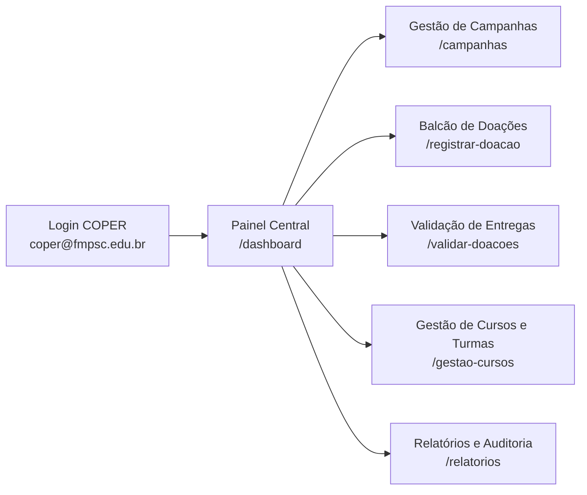
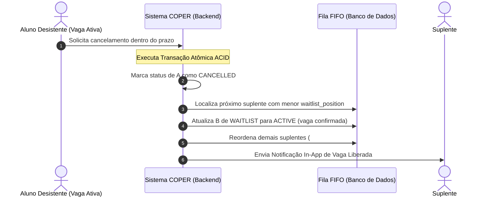

# 08 — Manual Operacional do Usuário e Roteiro de Apresentação da Banca

> **Sistema COPER 3.0 — Gestão de Doações e Cursos Extracurriculares**  
> **Faculdade Municipal de Palhoça (FMP)** — Curso de Análise e Desenvolvimento de Sistemas (ADS)  
> Projeto Integrador III (4ª Fase) | Professora Orientadora: Daniela Amorim  
> Versão do Documento: 3.0 | Atualizado em: Novembro 2026

---

## Sumário

1. [PARTE 1: Manual Operacional Rápido (Equipe COPER)](#parte-1-manual-operacional-rápido-equipe-coper)
   - [1.1. Acesso ao Sistema e Painel Geral](#11-acesso-ao-sistema-e-painel-geral)
   - [1.2. Gestão de Campanhas de Doação](#12-gestão-de-campanhas-de-doação)
   - [1.3. Gestão de Itens Prioritários e Urgências](#13-gestão-de-itens-prioritários-e-urgências)
   - [1.4. Atendimento de Balcão e Registro de Doações](#14-atendimento-de-balcão-e-registro-de-doações)
   - [1.5. Homologação e Validação de Entregas](#15-homologação-e-validação-de-entregas)
   - [1.6. Módulo Acadêmico: Cursos e Turmas Extracurriculares](#16-módulo-acadêmico-cursos-e-turmas-extracurriculares)
   - [1.7. Acompanhamento da Fila de Espera Automática (FIFO)](#17-acompanhamento-da-fila-de-espera-automática-fifo)
   - [1.8. Emissão de Relatórios Consolidados e Exportação (PDF/CSV)](#18-emissão-de-relatórios-consolidados-e-exportação-pdfcsv)
   - [1.9. Conferência e Auditoria de Fé Pública por QR Code / Hash](#19-conferência-e-auditoria-de-fé-pública-por-qr-code--hash)
2. [PARTE 2: Roteiro de Demonstração ao Vivo (Banca PI III — 15 Minutos)](#parte-2-roteiro-de-demonstração-ao-vivo-banca-pi-iii--15-minutos)
   - [2.1. Visão Geral e Cronometragem](#21-visão-geral-e-cronometragem)
   - [2.2. Preparação do Ambiente e Pré-Requisitos](#22-preparação-do-ambiente-e-pré-requisitos)
   - [2.3. Ato 1 (0:00 a 3:00) — Visão Pública, Landing Page e Doação Civil sem Login](#23-ato-1-000-a-300--visão-pública-landing-page-e-doação-civil-sem-login)
   - [2.4. Ato 2 (3:00 a 7:00) — Fluxo COPER de Validação, Horas e Fé Pública Digital](#24-ato-2-300-a-700--fluxo-coper-de-validação-horas-e-fé-pública-digital)
   - [2.5. Ato 3 (7:00 a 12:00) — Módulo de Cursos (Libras), Fila FIFO e Diário Digital](#25-ato-3-700-a-1200--módulo-de-cursos-libras-fila-fifo-e-diário-digital)
   - [2.6. Ato 4 (12:00 a 15:00) — Painel ESG (Empresário), LGPD e Fechamento](#26-ato-4-1200-a-1500--painel-esg-empresário-lgpd-e-fechamento)
   - [2.7. Tabela Resumo de Credenciais e Atalhos de Demonstração](#27-tabela-resumo-de-credenciais-e-atalhos-de-demonstração)

---

# PARTE 1: Manual Operacional Rápido (Equipe COPER)

Este manual destina-se aos servidores e colaboradores da **Coordenação de Extensão e Responsabilidade Social (COPER)** da FMP para operação diária do sistema durante os testes de homologação e a rotina acadêmica.

---

### 1.1. Acesso ao Sistema e Painel Geral

1. Acesse o endereço web do sistema no navegador (`http://localhost:5173` ou endereço de homologação institucional).
2. Clique no botão **"Entrar"** no canto superior direito da Landing Page ou acesse diretamente `/login`.
3. Insira as credenciais administrativas da COPER:
   - **E-mail:** `coper@fmpsc.edu.br`
   - **Senha:** `Coper@2026`
4. Ao autenticar, você será direcionado ao **Painel Geral Administrativo (`/dashboard`)**, onde são exibidos:
   - Indicadores em tempo real: Total de Doações Recebidas, Alunos Ativos Participantes, Horas Concedidas no Semestre e Cursos Ativos.
   - Atalhos operacionais de navegação rápida (menu lateral esquerdo).



---

### 1.2. Gestão de Campanhas de Doação

As campanhas agora contam com ciclo de vida rigoroso baseado em data de início e término (`data_inicio` e `data_limite`).

#### Como Criar uma Nova Campanha:
1. No menu lateral, clique em **"Campanhas"** (`/campanhas`).
2. No topo da tela, utilize o formulário **"Criar Nova Campanha"**:
   - **Título da Campanha\*:** Nome claro e institucional (ex: `Campanha do Agasalho de Inverno 2026`).
   - **Data de Início\*:** Data em que as doações começarão a ser aceitas.
   - **Data Limite\*:** Data de encerramento do recebimento físico.
   - **Limite de Horas por Aluno:** Teto de horas que um estudante pode obter nesta campanha específica (ex: `20` horas). Deixe em branco caso a campanha não tenha teto próprio.
   - **Descrição:** Objetivo social, público atendido e orientações de entrega na FMP.
3. **Adicionar Itens Específicos da Campanha:**
   - Clique em **"+ Adicionar Item"**.
   - Digite o nome do item (ex: `Cobertor Térmico Casal`).
   - Defina a meta de arrecadação (ex: `100`).
   - Defina a urgência: `Normal`, `Média` ou `Alta`.
4. Clique no botão **"Criar Campanha"**.

> [!NOTE]
> **Status Automático do Sistema:**
> - Se a `Data de Início` for futura: o sistema classifica a campanha como **`FUTURA`** (badge azul) e **bloqueia doações antecipadas**.
> - Se hoje estiver entre início e término: a campanha entra em **`ATIVA`** (badge verde) e fica disponível para doações.
> - Se a `Data Limite` for ultrapassada: a campanha muda para **`ENCERRADA`** (badge cinza) automaticamente.

---

### 1.3. Gestão de Itens Prioritários e Urgências

Para campanhas com demandas emergenciais (ex: enchentes, frentes frias ou carência alimentar):
1. Acesse o menu **"Itens Prioritários"** (`/itens-prioritarios`).
2. Cadastre itens que necessitam de incentivo extraordinário.
3. Ao definir a urgência como **`ALTA`**, o sistema destaca o item na Landing Page pública com alerta visual pulsante e calcula a conversão de horas com multiplicador prioritário configurado na regra de negócio (RN02).

---

### 1.4. Atendimento de Balcão e Registro de Doações

Quando um doador comparece pessoalmente à sala da COPER com os donativos físicos:
1. No menu lateral, clique em **"Registrar Doação"** (`/registrar-doacao`).
2. Preencha o formulário de recebimento:
   - **Matrícula do Aluno:** 
     - Digite a matrícula (ex: `19875`). O sistema localiza automaticamente o aluno.
     - *Caso seja um Professor ou Civil:* deixe o campo em branco ou informe o nome/e-mail no campo de observação.
   - **Campanha\*:** Selecione a campanha ativa correspondente no seletor suspenso.
   - **Tipo de Item\*:** Descrição do item entregue (ex: `Casaco de Lã`, `Pacote de Arroz 5kg`, `Kit Higiene`).
   - **Quantidade\*:** Quantidade física entregue e conferida.
   - **Local de Entrega:** Ponto físico na FMP (ex: `Balcão Central COPER - Sala 102`).
   - **Foto / Evidência (Opcional):** Anexe imagem dos itens caso seja exigido para auditoria.
3. Clique em **"Registrar Doação"**.
4. Uma mensagem verde de confirmação indicará que a doação foi registrada com sucesso.

---

### 1.5. Homologação e Validação de Entregas

Doações enviadas pelo aplicativo do aluno ou pré-registradas por civis entram com o status inicial **`PENDENTE`**. A homologação é necessária para conceder as horas e emitir os documentos com fé pública.

1. No menu lateral, clique em **"Validar Doações"** (`/validar-doacoes`).
2. Localize a doação na tabela de pendências.
3. **Para Aprovar:**
   - Clique no ícone de check verde (**Aprovar**).
   - O sistema valida automaticamente se a matrícula do aluno está ativa (RN05).
   - Se aprovado:
     - **Para Aluno:** calcula as horas devidas, soma ao saldo acumulado semestral e gera a **Declaração Oficial com Horas** (Modelo 1) com QR Code e Hash.
     - **Para Civil ou Professor:** aprova com `0h` (RN13) e emite o **Comprovante de Doação Solidária** (Modelo 2).
4. **Para Reprovar:**
   - Clique no ícone de 'X' vermelho (**Reprovar**).
   - O sistema solicitará o preenchimento obrigatório da justificativa da recusa (ex: `Alimentos com data de validade expirada`, `Item danificado`).
   - O status passa para `REPROVADA` e o estudante/doador é notificado do motivo.
5. **Para Corrigir Dados:** Utilize o ícone de lápis para ajustar quantidades ou tipagem antes de homologar.

> [!WARNING]
> **Bloqueio de Matrícula Inativa (RN05):** Caso você tente aprovar uma doação com horas para um aluno com matrícula trancada ou inativa, o sistema emitirá um alerta impeditivo em vermelho: *"Não é permitido conceder horas para estudantes com matrícula inativa."*

---

### 1.6. Módulo Acadêmico: Cursos e Turmas Extracurriculares

A COPER é responsável por cadastrar os cursos de extensão e abrir as turmas semestrais.

1. Acesse o menu **"Gestão de Cursos"** (`/gestao-cursos`).
2. **Cadastrar Novo Curso:**
   - Clique no botão **"+ Novo Curso"**.
   - Preencha: Título do Curso (ex: `Língua Brasileira de Sinais — Libras Básico`), Descrição temática, Instrutor/Professor responsável (selecione entre os docentes institucionais cadastrados), Carga Horária (ex: `40h`) e Frequência Mínima (padrão `75%`).
   - Clique em **"Cadastrar Curso"**.
3. **Abrir Turma para Inscrições:**
   - Clique no botão **"+ Nova Turma"**.
   - Vincule ao curso recém-criado.
   - Defina o Código da Turma (ex: `LIBRAS-2026-1`).
   - Defina a **Capacidade Máxima de Vagas** (ex: `25` vagas).
   - Estabeleça as datas: Início e Fim das Aulas, Período de Inscrição e o **Prazo Limite para Cancelamento** sem penalidade.
   - Clique em **"Salvar Turma"**.

---

### 1.7. Acompanhamento da Fila de Espera Automática (FIFO)

Quando uma turma atinge sua lotação máxima, o sistema não bloqueia novas inscrições: ele coloca os candidatos subsequentes em uma **Fila de Espera Automática (FIFO — First-In, First-Out)**.

1. Na página **"Gestão de Cursos"**, localize a turma desejada.
2. Clique no botão **"Ver Fila de Espera"** (ícone de lista ordenada).
3. Uma janela modal exibirá:
   - Total de vagas preenchidas vs. capacidade total.
   - Relação nominal dos alunos matriculados ativos.
   - Lista sequencial dos suplentes na fila: **Posição #1**, **Posição #2**, acompanhada da data e milissegundo de inscrição.



---

### 1.8. Emissão de Relatórios Consolidados e Exportação (PDF/CSV)

1. No menu lateral, acesse **"Relatórios"** (`/relatorios`).
2. Utilize os filtros superiores:
   - **Campanha:** Selecione uma campanha específica ou deixe em *"Todas as Campanhas"*.
   - **Data de Início e Data Final:** Estabeleça o intervalo desejado.
3. O painel carrega instantaneamente os 4 KPIs:
   - *Total de Doações*, *Alunos Participantes*, *Itens Arrecadados* e *Horas Concedidas*.
4. **Exportar PDF Institucional:**
   - Clique em **"Exportar PDF"**.
   - O sistema gera um documento A4 de alta definição com o brasão da FMP, resumo executivo de métricas por categoria e detalhamento nominal das entregas para prestação de contas da COPER.
5. **Exportar Planilha Excel / CSV:**
   - Clique em **"Exportar CSV"**.
   - O download do arquivo `.csv` inicia imediatamente, formatado com delimitador de ponto e vírgula (`;`) e codificação UTF-8 com BOM, abrindo perfeitamente no Microsoft Excel sem caracteres corrompidos.

> [!IMPORTANT]
> **Conformidade LGPD e Regra Temporal RN10:**
> - O intervalo do relatório não pode ultrapassar **365 dias (1 ano)** por requisição.
> - Relatórios operacionais bloqueiam registros com mais de **2 anos (730 dias)**, período em que os dados são automaticamente anonimizados pela rotina diária de expurgo LGPD.

---

### 1.9. Conferência e Auditoria de Fé Pública por QR Code / Hash

Qualquer documento gerado pelo Sistema COPER 3.0 (declarações de horas, comprovantes de doação solidária ou certificados de cursos) possui validade jurídica respaldada por criptografia.

1. Abra a página pública de validação: `http://localhost:5173/validar` (não exige login).
2. Você pode conferir a autenticidade de duas formas:
   - **Forma 1 (Câmera / Celular):** Aponte a câmera do celular para o QR Code impresso no canto inferior direito do PDF. O navegador abrirá diretamente a página de conferência com os dados carregados.
   - **Forma 2 (Código Hash):** Digite ou cole o código UUIDv4 (ex: `fmp-d001-lucas-agasalho-2026` ou `tok-lucas-libras`) no campo de busca e clique em **"Consultar Autenticidade"**.
3. O sistema exibirá o **Selo Verde Institucional de Documento Autêntico**, confirmando:
   - Nome completo do beneficiário e CPF mascarado;
   - Tipo de documento oficial emitido;
   - Quantidade de horas complementares reconhecidas pela FMP;
   - Campanha ou Curso de origem com nome do instrutor/homologador;
   - Data, hora e hash de emissão imutável.

---

# PARTE 2: Roteiro de Demonstração ao Vivo (Banca PI III — 15 Minutos)

Este roteiro foi estruturado para uma apresentação dinâmica de **12 a 15 minutos**, permitindo à equipe demonstrar à banca examinadora todos os módulos em funcionamento integrado, evidenciando o cumprimento de 100% dos requisitos acadêmicos e técnicos.

---

### 2.1. Visão Geral e Cronometragem

| Etapa | Duração | Foco Principal | Usuário / Tela |
| :--- | :---: | :--- | :--- |
| **Abertura & Contexto** | 1 min | Contextualização do problema na FMP e evolução da v2.0 para a v3.0 | Apresentador / Slides |
| **Ato 1: Visão Pública** | 2 min | Landing Page institucional, métricas de impacto e doação de Civil sem login | Público / `/` e `/impacto-social` |
| **Ato 2: Doações & Horas** | 4 min | Balcão COPER homologando doação, saldo automático e PDF com QR Code | COPER & Aluno / `/validar-doacoes` |
| **Ato 3: Cursos & Fila FIFO** | 5 min | Fila de espera, desistência atômica, diário de classe e diploma oficial | Aluno, COPER e Prof. / `/gestao-cursos` |
| **Ato 4: Visão Empresarial & QA** | 3 min | Painel ESG para empresas, governança LGPD e suíte de 62 testes automatizados | Empresário & Equipe / `/painel-impacto` |

---

### 2.2. Preparação do Ambiente e Pré-Requisitos

Antes de iniciar a apresentação perante a banca:
1. Abra um terminal na pasta do projeto e garanta o banco povoado com dados realistas da FMP:
   ```bash
   npm run seed:demo --prefix backend
   ```
2. Inicie os servidores de backend e frontend:
   ```bash
   # Terminal 1: Backend
   npm run dev --prefix backend
   
   # Terminal 2: Frontend
   npm run dev --prefix client
   ```
3. Deixe preparadas 3 janelas ou abas no navegador:
   - **Aba 1 (Pública / Anônima):** `http://localhost:5173/` (Landing Page).
   - **Aba 2 (COPER):** `http://localhost:5173/login` (Pronto para entrar como `coper@fmpsc.edu.br`).
   - **Aba 3 (Validação Pública):** `http://localhost:5173/validar`.

---

### 2.3. Ato 1 (0:00 a 3:00) — Visão Pública, Landing Page e Doação Civil sem Login

**Narrativa do Apresentador:**
> *"Iniciamos a apresentação demonstrando como o Sistema COPER 3.0 transformou a relação da Faculdade Municipal de Palhoça com a sociedade. Antigamente, a arrecadação dependia exclusivamente de cadernos e doações de balcão de alunos. Agora, possuímos um portal moderno, responsivo e aberto à comunidade externa."*

#### Ações Práticas na Tela:
1. **Navegar pela Landing Page (`/`):**
   - Destaque o Dark Mode profissional em tons de azul institucional e ciano.
   - Mostre a seção de **Impacto Social em Números**:
     - *+1.450 Famílias Atendidas*;
     - *+3.200 Horas de Extensão Computadas*;
     - *+4.800 kg de Alimentos Arrecadados*.
   - Role até a vitrine de **Campanhas Ativas** e **Cursos Extracurriculares**.
2. **Executar Doação Comunitária de Civil (Sem Necessidade de Login):**
   - No cabeçalho, clique no botão destacado: **"Doação Comunitária (Sem Login)"**.
   - No modal interativo, preencha:
     - **Nome:** `Carlos Eduardo Souza`
     - **E-mail:** `carlos.civil@gmail.com`
     - **Telefone:** `(48) 99887-1122`
     - **Campanha:** `Campanha do Agasalho FMP 2026`
     - **Item:** `Cobertor Térmico`
     - **Quantidade:** `3`
     - **Ponto de Coleta:** `Balcão Central COPER - Bloco A`
   - Clique em **"Confirmar Doação Comunitária"**.
3. **Exibir o Resultado:**
   - Mostre o modal de sucesso com o **Protocolo Digital** gerado instantaneamente e explique à banca que este doador civil receberá um comprovante auditável sem precisar criar senha ou ter vínculo estudantil.

---

### 2.4. Ato 2 (3:00 a 7:00) — Fluxo COPER de Validação, Horas e Fé Pública Digital

**Narrativa do Apresentador:**
> *"Agora entraremos na visão operacional da COPER para demonstrar a substituição dos antigos recibos de papel por uma esteira 100% digital, segura e com auditoria de horas complementares em tempo real."*

#### Ações Práticas na Tela:
1. **Login Administrativo COPER:**
   - Acesse `/login`, preencha `coper@fmpsc.edu.br` / `Coper@2026` e clique em Entrar.
   - Mostre o Painel Central da COPER com os indicadores do semestre.
2. **Homologar Doação Pendente:**
   - Acesse `/validar-doacoes`.
   - Na lista, aponte a doação pendente do aluno **Lucas Schutz** (`10 kg de Arroz Integral`).
   - Clique no ícone de check verde (**Aprovar**).
   - O toast verde confirma: *"Doação aprovada com sucesso! 10 horas complementares concedidas."*
3. **Conferência no Portal do Aluno:**
   - Abra uma aba anônima e faça login como o estudante:
     - **E-mail:** `lucas.schutz@aluno.fmpsc.edu.br` | **Senha:** `Aluno@2026`.
   - Na tela inicial (`/meu-painel`), mostre o gráfico de pizza de horas: o saldo subiu imediatamente e a doação homologada aparece na listagem recente.
   - Clique no botão **"Baixar Declaração (PDF)"**.
4. **Auditoria do PDF e Validação Pública de Autenticidade:**
   - Abra o PDF baixado (ou exiba o modelo na tela).
   - Mostre o cabeçalho oficial da FMP, os dados do aluno, a quantidade de horas expressas e o **QR Code no rodapé**.
   - Copie o código hash exibido no documento: `fmp-d001-lucas-agasalho-2026`.
   - Acesse a aba pública `/validar`.
   - Cole o código no campo de busca e clique em **"Consultar Autenticidade"**.
   - Mostre o **Selo Verde Institucional de Documento Autêntico** atestando a fé pública da declaração.

---

### 2.5. Ato 3 (7:00 a 12:00) — Módulo de Cursos (Libras), Fila FIFO e Diário Digital

**Narrativa do Apresentador:**
> *"Este é um dos grandes diferenciais da Versão 3.0: a unificação do voluntariado com a extensão universitária. Demonstraremos agora o algoritmo de Fila de Espera FIFO com transação atômica e o Diário de Classe Digital do Professor."*

#### Ações Práticas na Tela:
1. **Demonstrar Turma Lotada e Fila de Espera:**
   - Entre na visão da COPER em `/gestao-cursos`.
   - Mostre a turma de **Libras Básico (`LIBRAS-2026-1`)**: capacidade máxima preenchida (`4/4` alunos ativos).
   - Clique em **"Ver Fila de Espera"**: mostre que os alunos **Vitor Emanuel (#1)** e **Nicolas (#2)** estão na fila de espera aguardando vaga.
2. **Desistência e Promoção Atômica Imediata:**
   - Na aba do aluno matriculado que deseja desistir antes do prazo, clique em **"Cancelar Matrícula"**.
   - Volte imediatamente à tela da COPER e atualize a Fila de Espera:
     - Mostre à banca que o aluno **Vitor Emanuel** foi promovido instantaneamente para **Vaga Ativa (`ACTIVE`)**.
     - O suplente **Nicolas** passou de posição #2 para **Posição #1 da fila**.
     - Destaque que essa operação foi realizada dentro de uma transação ACID no PostgreSQL, garantindo integridade absoluta de concorrência.
3. **Diário de Classe Digital do Professor:**
   - Faça logout e entre com o perfil do professor de Libras:
     - **E-mail:** `prof.libras@fmpsc.edu.br` | **Senha:** `Prof@2026`.
   - O professor cai diretamente na tela `/diario-classe`.
   - **Chamada Online:** Selecione a data de hoje, marque presença para a turma e clique em **"Salvar Frequência"**.
   - **Lançamento de Notas:** Mude para a aba **"Notas ($A_1, A_2, A_3$)"**.
   - Mostre o cálculo automático da média formativa:
     $$\text{Média} = \frac{A_1 + A_2 + A_3}{3}$$
   - Preencha notas aprovatórias para Lucas Schutz ($A_1 = 9.0, A_2 = 8.5, A_3 = 9.5$) e reprovatórias para outro estudante.
4. **Fechamento de Turma e Emissão de Diplomas:**
   - Clique no botão **"Encerrar Turma"**.
   - O sistema valida o critério duplo da FMP: $\text{Frequência} \ge 75\%$ e $\text{Média} \ge 7.0$.
   - Os aprovados recebem automaticamente o **Certificado de Conclusão de Curso Extracurricular (Diploma Paisagem)** contendo carga horária de 40 horas e QR Code próprio.

---

### 2.6. Ato 4 (12:00 a 15:00) — Painel ESG (Empresário), LGPD e Fechamento

**Narrativa do Apresentador:**
> *"Para finalizar, apresentamos a interface de sustentabilidade corporativa para empresas parceiras da FMP e a maturidade de engenharia de software do projeto."*

#### Ações Práticas na Tela:
1. **Painel do Empresário / Parceiro:**
   - Acesse com o perfil empresarial:
     - **E-mail:** `parceiro@empresa.com.br` | **Senha:** `Empresa@2026`.
   - Mostre o **Dashboard de Impacto Social Integrado**:
     - Gráficos consolidados de apoio comunitário;
     - Relatórios de impacto adequados para balanços ESG e responsabilidade social;
     - Garantia de privacidade: a empresa visualiza totais agregados e métricas sociais sem ter acesso aos dados sensíveis dos alunos doadores (em conformidade estrita com a LGPD).
2. **Rotina de Retenção LGPD e Exportação de Relatórios:**
   - Mostre brevemente a tela `/relatorios` da COPER com os botões funcionais de exportação de **PDF Institucional** e planilha **CSV formatada**.
   - Mencione a rotina automatizada `scheduleRetentionJob()` executada diariamente via `node-cron`, que expurga doações órfãs com mais de 2 anos e anonimiza registros auditáveis com certificado.
3. **Qualidade de Código e Conclusão:**
   - Abra o terminal e execute `npm test --prefix backend`.
   - Aponte para a banca o resultado de **62 testes automatizados executados e 100% aprovados** (Vitest + Supertest) em menos de 3 segundos.
   - Apresente a pasta [`documentacao/`](file:///c:/Users/lucas/Downloads/gestaodoacaonovo/documentacao) contendo todos os 9 manuais de engenharia de software da Versão 3.0.
   - Conclua agradecendo à banca e à professora orientadora Daniela Amorim.

---

### 2.7. Tabela Resumo de Credenciais e Atalhos de Demonstração

Para facilidade dos apresentadores durante a arguição da banca, mantenha esta colinha em mãos:

| Perfil | E-mail | Senha | Rota Principal | Objetivo na Apresentação |
| :--- | :--- | :--- | :--- | :--- |
| **COPER (Admin)** | `coper@fmpsc.edu.br` | `Coper@2026` | `/dashboard` | Validação de balcão, gestão de cursos e relatórios |
| **Professor (Libras)** | `prof.libras@fmpsc.edu.br` | `Prof@2026` | `/diario-classe` | Chamada online, notas A1/A2/A3 e emissão de diplomas |
| **Aluno (Lucas)** | `lucas.schutz@aluno.fmpsc.edu.br` | `Aluno@2026` | `/meu-painel` | Consulta de saldo de horas, histórico e download de PDF |
| **Aluno (Vitor / Suplente)**| `vitor.emanuel@aluno.fmpsc.edu.br`| `Aluno@2026` | `/meus-cursos` | Demonstração da fila FIFO e promoção de vaga |
| **Empresário** | `parceiro@empresa.com.br` | `Empresa@2026` | `/painel-impacto` | Visualização de KPIs sociais consolidados (ESG) |
| **Civil (Anônimo)** | *Não requer login* | *Não requer* | `/` | Doação solidária rápida pela Landing Page |

#### Chaves Prontas para Validação Pública na Rota `/validar`:

- Declaração de Doação com Horas (Aluno): `fmp-d001-lucas-agasalho-2026`
- Comprovante de Doação Solidária sem Horas (Civil): `tok-civil-001`
- Certificado Oficial de Conclusão de Curso (Libras): `tok-lucas-libras`
